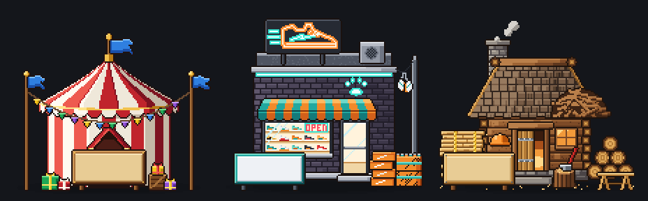

# Blitz's home on the town square: Blitz's Kicks (Nov 3)

Eric's design (relayed by the director): "a straight up sneaker store ... the outside can do the neon lighting, no chess
clocks needed, it's funnier that way." Brief: `scripts/boss-art/briefs/blitz-house-and-shop.md`. Drawing:
`house-blitz/house-blitz.ts`. It's art only.

## Cost
**Drawn by hand on the weekly plan usage** (Eric, Nov 3: the API art runner's credit is out), not the runner. Same file
and format the runner makes.

## The home

- **The shop:** a flat-roofed little store of charcoal painted brick on a concrete plinth, the roof deck showing over its
  parapet, an air-conditioning box on the roof.
- **Neon:** a big orange neon sneaker (a teal lightning stripe on its side, teal speed lines behind its heel) on a black
  billboard on the roof; a teal tube all along the roofline; a teal neon cheetah paw over the door; a red OPEN sign
  hung in the window.
- **The front:** a teal and orange striped awning over a big window of sneakers on lit shelves (ten colorways, one
  cheetah print), and a glass door with a push bar.
- **Outside:** a white pair of sneakers hanging by their laces from a wire strung to a pole; a stack of orange shoe boxes
  with white stripes by the door; two cases of Cheetah Chug (orange, cheetah spots, a teal band), the top one open on its
  cans.
- **The sign:** a blank white board in a teal frame on two black posts, for the game to write on.
- **No chess clocks** anywhere.
- **Idle:** 6 frames at 200 ms. The neon buzzes: the speed lines blink off twice a loop, the OPEN sign's N stutters, the
  tubes hum a little; the hanging sneakers sway: [house-blitz-idle.gif](house-blitz/house-blitz-idle.gif) (3x).

## For the code helper
- `HOUSE_BLITZ` (id `house-blitz`): 144 x 134, foot (72, 128), a 3 x 3 plot like the other homes.
- `HOUSE_BLITZ_SIGN` (board at (8, 102), 50 x 22).
- `HOUSE_BLITZ_LIGHTS`: the neon in its own colors (the sneaker orange with a 34 px halo, its stripe and speed lines and
  the roofline and the paw teal, OPEN red with a small halo), the window and the door warm. The flickers are frame
  palette changes, so the lights follow the keys (`^~` the speed lines, `*` the N).
- `HOUSE_BLITZ_POOLS`: warm light before the window and door, and a faint teal wash along the front.

## Calls Eric may want to change
- **The name:** the picture is named "Blitz's Kicks". The game writes the home's name, so this is the wiring helper's
  (or Eric's) to set.
- **A dark front:** charcoal brick makes the neon pop at night; by day it's the darkest home on the square.
- **The hanging pair** hangs from a wire to a street pole on its right, the square's only pole.
- **The sign** is white in a teal frame, not the cream wood of the older homes.
