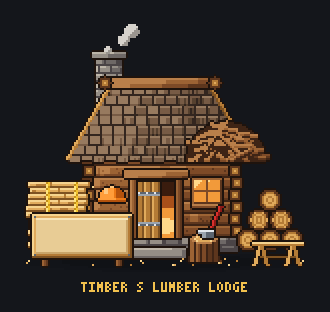

# Timber's home on the town square: Timber's Lumber Lodge (Nov 3)

Eric asked for Timber's house (relayed by the director) and approved the spend in my own dialog (capped at $5). Brief:
`scripts/boss-art/briefs/house-timber.md`. Drawing: `house-timber/house-timber.ts`.

## Cost
**$1.71** of the $5 cap, 22 turns. It finished and called done (`house-timber/summary.md`).

## The home

- **The cabin:** log walls on a stone footing, a shingle roof with a log ridge, a stone chimney, and a beaver-lodge heap
  of sticks on the right of the roof.
- **The front:** a plank door with iron straps standing a little open with firelight inside, and a warm window.
- **Lumber:** a rope-tied plank stack, a log pile with a sawhorse, and a chopping stump with a red-handled axe. His
  orange hard hat hangs on a peg.
- **The sign:** a blank plank sign on log posts, for the game to write on.
- **Idle:** 6 frames at 220 ms. Chimney smoke, flickering firelight and a couple of wood chips tumbling:
  [house-timber-idle.gif](house-timber/house-timber-idle.gif).

## For the code helper
- `HOUSE_TIMBER` (id `house-timber`): 144 x 134, foot (70, 128), a 3 x 3 plot like the other homes.
- `HOUSE_TIMBER_SIGN` (board at (6, 102), 50 x 22).
- `HOUSE_TIMBER_LIGHTS` (the door and the window) and `HOUSE_TIMBER_POOLS` (warm light in front of the door).
