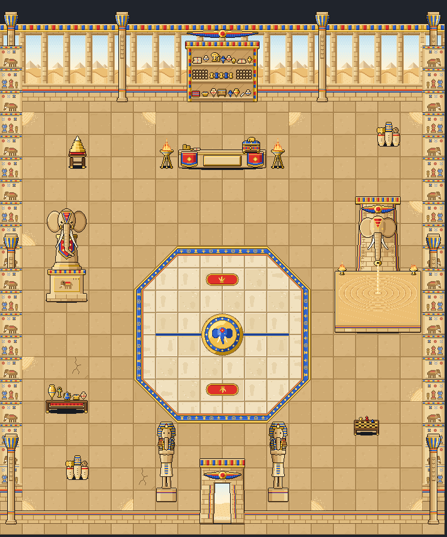

# Alfil's shop: inside the pyramid (Nov 2)

Eric asked for Alfil's home (relayed by the director) and approved the spend in my own dialog (about $4 to $7, capped at
$10). Eric's words: "pyramids, pharaoh statue, artifacts, shiny relics etc. Egyptian style etchings on the walls, and the
elephant chess piece as a large statue", with the clean "windows" back wall he liked in the greenhouse.

Brief: `scripts/boss-art/briefs/shop-alfil-interior.md`. Drawing: `house-shop-alfil/house-shop-alfil.ts`, built the
same way as the other two shops:
- each piece is its own `Character`, `shop-alfil-<name>`, in `SHOP_ALFIL_PIECES`;
- `SHOP_ALFIL_LAYOUT` places them;
- `HOUSE_SHOP_ALFIL` is the room still;
- `SHOP_ALFIL_LIGHTS` and `SHOP_ALFIL_POOLS` light the fires.

It's art only: nothing is wired into the game yet. The Shopkeeper is the baby mammoth's existing sprite.

## Cost
- Opus 5.5, effort high, the runner's spend guard on: **$5.97** of the $10 cap, 48 turns and 28 renders. It finished
  and called done (`house-shop-alfil/summary.md` has its full notes).
- **Shops so far:** Babur $7.16, Puddles $6.17, Alfil $5.97.

## The room: 20 x 20 squares (37 px a square)

- **Back wall:** tall openings between papyrus columns look out on a pale sky, dunes and distant pyramids. That's the
  clean, bright effect from the greenhouse, here in sandstone.
- **Counter:** behind the counter is a painted shrine of shelves (scrolls, jars, gems, a gold elephant head, a row of
  chess pieces) under a winged sun disk.
- **Side walls:** carved and painted with a procession of elephants, and the old alfil piece beside the shah.
- **Battle circle:** an octagon of polished pale stone. It has a gold, blue and red border of ankhs, sun disks and little
  chess pieces, and Alfil's head in blue on a gold sun disk in the middle. Red start pads with a gold lotus sit north and
  south, with a gold and blue line across the middle.
- **Props:**
  - the big elephant-piece statue on the left;
  - the sand fountain (the showpiece) on the right;
  - a gold pyramid model, canopic urns, a relic table and a shatranj table;
  - two elephant-headed pharaoh statues guarding the door.
- **Paths:** the way from the door to the counter (columns 9-10) is clear, and the circle is walkable.

## The animated showpiece: the Elephant Sand Fountain (the artist's pick)
- **What it is:** a sandstone pylon with a winged sun disk and Alfil's carved head. His trunk curls into a gold spout that
  pours golden sand into a wide stone basin, with small fires burning on the basin's back corners.
- **Why:** it's Alfil (an elephant), it's the desert (sand instead of water), and it's calm, like an hourglass that never
  stops.
- **Size:** 4 x 3 squares (148 x 233 px), at columns 15-18, rows 8-10.
- **Loop:** 8 frames at 130 ms. Grains run down the stream, rings spread across the sand from where it lands, grains kick
  up, and the two fires flicker out of step.
- **How it's built:** the basin's sand is drawn as a plan (it lies flat, `d: 3`), and the pylon stands upright at its back.
- **Also animated:** the crate's glint, the relics' sparkle, the pyramid model's capstone and the braziers.

## The main pieces (width x height in px; squares)
| Piece | Size | Notes |
|---|---|---|
| `floor-a`, `floor-b`, `floor-c`, `floor-d`, `floor-door` | 37 x 37 | Calm sandstone flags; drifted sand, a crack, daylight. |
| the circle's tiles | 37 x 37 each | The edge, diagonals, corners, line, start marks and the 2 x 2 emblem. |
| `wall`, `wall-b` | 37 x 130 | The openings onto the desert (two views, alternating). |
| `wall-pillar` | 37 x 150 | A papyrus column. |
| `wall-side`, `wall-side-b`, `wall-side-pillar` | 37 x 130, 37 x 150 | Etched side walls. |
| `entrance` | 74 x 112; 2 x 3 | A stone gateway with a sun disk and bright sand outside. |
| `backdrop` | 148 x 150; 4 x 4 | The painted shelf shrine. |
| `counter` | 148 x 44; 4 x 1 | The body is 29 px tall, so the kid shows behind it. Blank plaque `SHOP_ALFIL_COUNTER_SIGN`. |
| `crate` | 30 x 27 | **Alfil's Boss Crate**: a cedar casket, blue lid, gold corners and a gold elephant. At `SHOP_ALFIL_CRATE_AT` = (122, 15). |
| `elephant-statue` | 74 x 174; 2 x 1 | The alfil as a great chess piece on a carved plinth. |
| `pharaoh-statue` | 44 x 146 | An elephant-headed king with crook and flail (two, by the door). |
| `sand-fountain` | 148 x 233; 4 x 3 | The showpiece. |
| `pyramid-model`, `relics`, `urns` | 40 x 62, 74 x 62, 40 x 52 | Gold pyramid; relic table; canopic jars. |
| `brazier`, `chess-table` | 30 x 62, 44 x 46 | The artist's two extras. |

## Inside, through the town's camera (mockup, Close zoom: the default inside)
- At the counter, with the kid: [view-close-at-counter.png](house-shop-alfil/view-close-at-counter.png)
- In the battle circle: [view-close-in-circle.png](house-shop-alfil/view-close-in-circle.png)
- By the elephant statue: [view-close-statue.png](house-shop-alfil/view-close-statue.png)
- The sand fountain, animated: [view-close-fountain.gif](house-shop-alfil/view-close-fountain.gif)
- Zoomed out, in the circle: [view-inside-circle.png](house-shop-alfil/view-inside-circle.png)

The ceiling above the walls is drawn by the mockup script, not the art.

## Calls Eric may want to change
- The two pharaoh statues by the door are fairly slim.
- The entrance's opening is only about 26 px wide.
- The fountain's sand stream, where it crosses the flat basin, lies flat with it.
