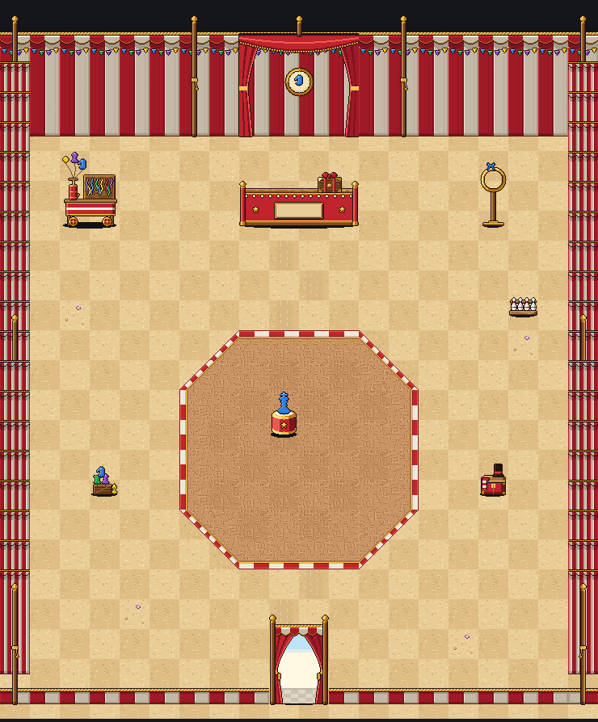
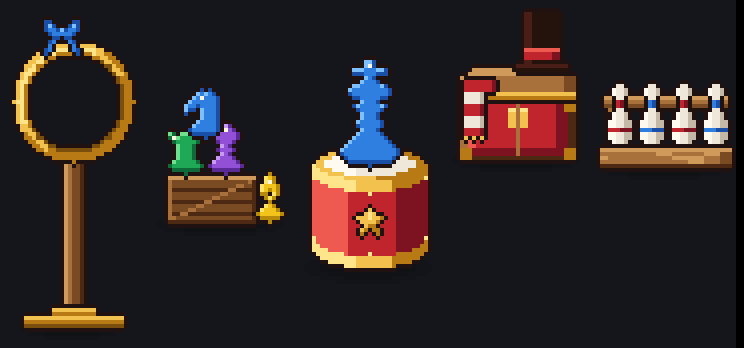

# Babur's shop: inside the circus tent (Nov 2)

Eric asked for the inside of Babur's shop (Nov 2) and approved the spend in the dialog (about $4 to $7, capped at $10).
Brief: `scripts/boss-art/briefs/shop-babur-interior.md`. Drawing: `house-shop-babur/house-shop-babur.ts` (one file:
each piece is its own `Character`, `shop-babur-<name>`, all in `SHOP_BABUR_PIECES`; where they go is in
`SHOP_BABUR_LAYOUT`; the whole room as one still is `HOUSE_SHOP_BABUR`). It's art only and nothing is wired into the
game yet. The code helper builds the "Go in" view from this. The Shopkeeper is Stripes' existing sprite, so no new art
was drawn for it.

## Cost
- Opus 5.5, effort high, adaptive thinking, the runner's spend guard on.
- **First try: $1.14**, with no drawing. It tried to write the whole file in one turn and ran past the 48,000-token limit
  for a turn (`house-shop-babur/summary-try1.md`).
- **Second try: $3.37** over 27 turns and 19 renders, and it finished. For this try the limit for a turn was raised to
  96,000 tokens, and the brief told it to build the file in steps (`house-shop-babur/summary.md`).
- **Total: $4.51** of the $10 cap.

## The room: 20 x 20 squares (37 px a square)

`house-shop-babur/room.png` is 740 x 894 px: the floor plan with each upright piece standing at its foot, and the back
wall rising above row 0. The camera looks north and you come in at the bottom.
- **Back wall:** a little stage behind the counter, with drapes and a balloon-knight medallion.
- **Counter:** at row 3, with the crate on it. Stripes stands behind it on row 2.
- **Props:** the balloon cart is top left and the cold hoop top right. The juggling-pin rack is on the right, and the
  balloon chess stack and the costume trunk are lower left and lower right.
- **Ring:** an octagon with the balloon king on its pedestal in the middle.
- **Front:** a low striped hem with the entrance flap at columns 9-10. That's the way out.
- **Walking:** there's a clear way at least 2 squares wide from the door to the counter, and the ring is walkable.

## The pieces (width x height in px; squares)
| Piece | Size | Notes |
|---|---|---|
| `floor-a`, `floor-b` | 37 x 37; 1 x 1 | Sawdust in two straw tones. Flat and top-down, and they tile with no seams. |
| `floor-c` | 37 x 37; 1 x 1 | Shavings and a purple balloon scrap, on the a tone only. |
| `floor-d` | 37 x 37; 1 x 1 | A scuffed path, on the b tone only. |
| `floor-door` | 37 x 37; 1 x 1 | Daylight spilling in, used on the two squares inside the flap. |
| `ring-a`, `ring-b` | 37 x 37; 1 x 1 | Darker, redder raked sawdust. They look the same turned any way. |
| `ring-edge` | 37 x 37; 1 x 1 | The red and white curb with a gold lip. The layout turns it with `rot`. |
| `ring-edge-diag`, `ring-edge-diag-b`, `ring-edge-corner` | 37 x 37; 1 x 1 | The octagon's 45° sides, and the square just inside each of its corners. |
| `wall` | 37 x 130; 1 x 3.5 | The striped canvas, a gold rope, a scalloped valance and bunting. It tiles side by side. |
| `wall-pole` | 37 x 150; 1 x 4 | A wall with a wooden tent pole, a gold ball on top and a rope tie. |
| `wall-side`, `wall-side-pole` | 37 x 130 and 37 x 150; 1 square | The side walls as receding pleats. Drawn for the west wall; the east wall uses them flipped. |
| `hem`, `hem-pole` | 37 x 20 and 37 x 150; 1 square | The low front wall and its corner poles. |
| `entrance` | 74 x 112; 2 x 3 | Curtains tied back with gold and bright day between them. Marked `exit: true` in the layout. |
| `backdrop` | 148 x 150; 4 x 4 | Extra. The back wall behind the counter, dressed as a little stage. |
| `counter` | 148 x 58; 4 x 1.5 | A red ticket-booth counter with unlit bulbs and gold stars. Its blank plaque is `SHOP_BABUR_COUNTER_SIGN`. |
| `crate` | 30 x 27; about 1 x 1 | **Babur's Boss Crate**: red bands, gold corners and a bow of balloons. It sits at `SHOP_BABUR_CRATE_AT` = (112, 13) in counter pixels. Idle: a glint moves round its corners (4 x 450 ms). |
| `balloon-stand` | 74 x 96; 2 x 2.6 | The balloon-twisting cart, with a pump and limp balloons. Idle: its balloons bob 1 px, out of step (4 x 300 ms). |
| `hoop-stand` | 37 x 86; 1 x 2.3 | A **cold** gold hoop with a blue ribbon. No fire. |
| `balloon-stack` | 37 x 60; 1 x 1.6 | A balloon rook, pawn, knight and bishop on a low crate. |
| `pedestal` | 37 x 72; 1 x 2 | A red and gold drum with a big blue balloon king on it. |
| `trunk` | 37 x 44; 1 x 1.2 | Extra. A costume trunk with a top hat and a striped scarf. |
| `pin-rack` | 37 x 46; 1 x 1.2 | Extra. Juggling pins on a rack. |

## For the code helper
- **Feet:** the art puts a wide piece's foot at the middle of its width, on the middle of its row. If the game measures
  from the front edge instead, shift wide pieces by half a square.
- **Review-only pictures:** `HOUSE_SHOP_BABUR`'s extra animations (each piece scaled up, plus `review-*`) are for
  checking the art. The game uses the separate piece Characters.
- **Palette:** it's tiger.ts's tent palette value for value, plus a few added keys: the inside's shaded canvas, the
  sawdust, the ring and the daylight.
- **Calls Eric may want to change:**
  - whether the extras stay: the backdrop, the trunk and the pin rack;
  - the king balloon's color: it's blue because a red one disappears against the red drum;
  - the balloon stack, which is a little small.
- The file typechecks (`npx tsc -p scripts/boss-art --noEmit`).

## Inside, through the town's camera (mockup)
`npx tsx scripts/boss-art/shop-view.ts <out.png> <col> <row>` lays the room out through town/camera.ts (the town's zoomed-in
phone camera, 390 x 844), with your pawn and Stripes at the town's sizes. The ceiling stripes above the walls are drawn by the
mockup script, not the art. Stripes stands beside the counter's east end: behind it, the 58 px counter hides Stripes.

- In the ring, looking north to the counter: [view-inside-ring.png](house-shop-babur/view-inside-ring.png)
- Two squares from the counter: [view-at-counter.png](house-shop-babur/view-at-counter.png)
