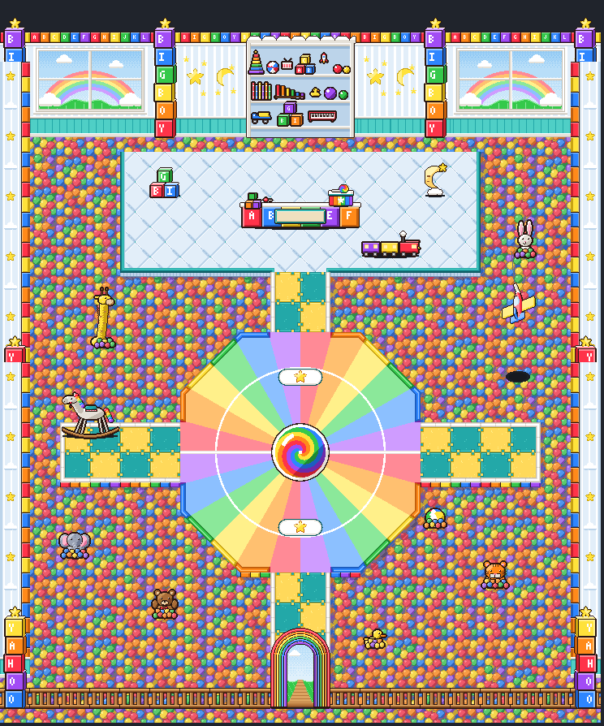

# Big Boy's shop: inside the crib (Nov 2)

Eric's design: a ball-pit floor with stuffed animals, the shop and battle circle built over the pit and joined by a
walkway, a toy plane circling on a string as the showpiece, and a toy-block theme. He approved the spend in my own dialog
(about $4 to $7, capped at $10). Brief: `scripts/boss-art/briefs/shop-bigboy-interior.md`. Drawing:
`house-shop-bigboy/house-shop-bigboy.ts`, built like the other shops:
- each piece is its own `Character` in `SHOP_BIGBOY_PIECES`;
- `SHOP_BIGBOY_LAYOUT` places them, and every pit square is solid;
- `HOUSE_SHOP_BIGBOY` is the room still;
- `SHOP_BIGBOY_LIGHTS` and `SHOP_BIGBOY_POOLS` light the night light and the train;
- `SHOP_BIGBOY_COUNTER_SIGN` and `SHOP_BIGBOY_CRATE_AT` = (124, 15).

It's art only. The Shopkeeper is the teddy kid's existing sprite.

## Cost
**$6.10** of the $10 cap, 31 turns and 18 renders. It finished and called done (`house-shop-bigboy/summary.md`).

## The room

- **Floor:** a ball pit of red, yellow, blue and green balls, with the odd orange and purple. Where it meets a raised floor
  you see the toy-block side under it.
- **Walkway:** teal and yellow foam puzzle-mat squares with white bumpers. It runs from the door north to the circle, from
  the circle to the shop platform, and east and west arms lead to the plane and the rocking horse.
- **Shop platform:** a pale blue quilted crib mattress (columns 4-15, rows 1-4). On it are the letter-block counter (A to
  F, with a blank plaque, 29 px tall so the teddy shows), the rainbow toy-box crate with a lollipop on top, B-I-G blocks,
  a sleepy-moon night light and a toy train that puffs steam.
- **Battle circle:** a play parachute of pastel rainbow wedges with a rainbow bumper, a lollipop-swirl emblem, white star
  start pads and a white middle line. **Its start marks are north and south**: it was already drawing when Eric's "boss on
  left, you on right" note came in (`docs/decisions/2026-11-02-battle-sides.md`). The marks can be turned to west and east
  in the layout.
- **Back wall:** two big windows with a rainbow over green hills, nursery stripes with stars and moons, an alphabet-block
  frieze spelling BIG BOY along the top, and B-I-G-B-O-Y block columns. The backdrop is a white toy shelf.
- **Side walls:** stacks of toy blocks.
- **Entrance:** a rainbow stacking-toy arch with daylight through it.
- **In the pit:** a giraffe, a tiger, a bear with a red bow, an elephant, a duck and a bunny, each half sunk in the balls,
  plus a beach ball and a rocking horse.

## The showpiece: the toy plane
- **Size and place:** 111 x 211 px (3 x 3 squares), over the pit east of the circle (columns 15-17, rows 7-9). The east
  walkway arm passes just south of it.
- **Loop:** 16 frames at 90 ms. A red plane with yellow wings and a blue tail flies round on its string: away up the
  right, small across the back, toward you down the left, big across the front. It banks into the turn, its propeller
  spins, and its shadow follows it round on the balls.
- **Previews:** the plane alone at 3x, [airplane-3x.gif](house-shop-bigboy/airplane-3x.gif); in the room,
  [view-close-airplane.gif](house-shop-bigboy/view-close-airplane.gif).

## Views (mockup, Close zoom; the ceiling is drawn by the mockup, not the art)
- At the counter: [view-close-at-counter.png](house-shop-bigboy/view-close-at-counter.png)
- In the circle: [view-close-in-circle.png](house-shop-bigboy/view-close-in-circle.png)

## Calls Eric may want to change
- **The plane is small for a showpiece**, about 1 square across at the front of its loop. It flies high, near the
  ceiling, so up close it sits at the top of the screen. Eric asked for bigger showpieces in the other shops.
- **The ball pit is lively up close.** It could drop to fewer colors.
- The circle's wedges are pastel; they could be bolder.
- The circle's start marks are north and south (see above).
