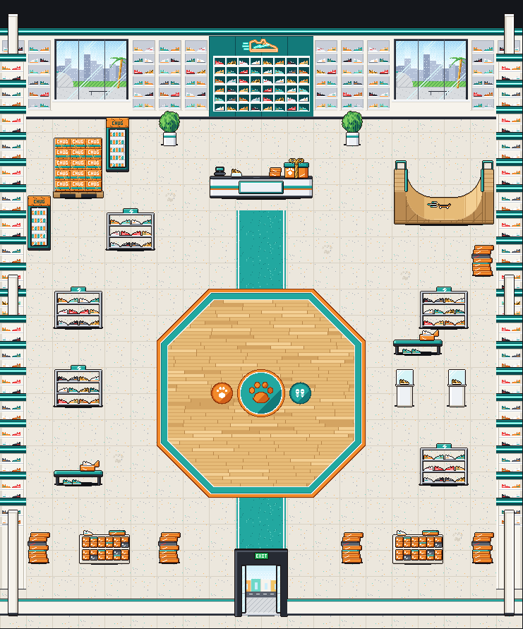

# Blitz's shop: inside Blitz's Kicks (Nov 3)

Eric's design (relayed by the director): "Just a straight up sneaker store, wall to wall with sneakers on display, also
some rows/racks with shoes / shoe boxes, a halfpipe, a big pallet of energy drink cases called Cheetah Chug ... no chess
clocks needed, it's funnier that way." Brief: `scripts/boss-art/briefs/blitz-house-and-shop.md`. Drawing:
`house-shop-blitz/house-shop-blitz.ts`, built exactly as Timber's shop is. It's art only.

## Cost
**Drawn by hand on the weekly plan usage** (Eric, Nov 3: the API art runner's credit is out), not the runner. Same
exports and format the runner makes.

## The room

- **Floor:** pale terrazzo in big tiles with a soft grout line and a few grey, teal and orange chips. A few tiles carry
  black skid marks or a faint dusty paw print. A teal running lane with white side lines runs from the door (a white
  start line) to the circle and on to the counter (columns 9-10, rows 4-6 and 15-18).
- **Back wall:** a teal fascia with a neon tube along the top; white walls of lit sneaker shelves (six shelves, twelve
  pairs a square) between two big three-pane windows onto a sunny skate park (a quarter pipe, a rail, a palm, the city's
  towers far off). White pilasters at the corners.
- **Behind the counter (backdrop, 4 x 1):** a teal feature wall of white cubbies, 48 sneakers lit from above, under the
  orange neon sneaker from the roof outside.
- **Counter (4 x 1):** glossy white with a teal and an orange stripe and a black top, **30 px tall**, so the kid shows
  over it. A register, a sneaker on a clear riser, two shoe boxes, and a blank plaque in a teal frame.
- **Crate:** Blitz's Boss Crate, a big orange shoe box with a teal lid, a cream paw print and a white stripe, a
  cheetah-spotted ribbon in a bow on top. Idle: a glint runs along the lid and winks on the bow (6 frames, 220 ms).
- **Racks and rows:** chrome racks of twelve sneakers (two colorway sets: `rack`, `rack-b`), tall stacks of orange shoe
  boxes (one teal lid, one black box), low white shelves of boxes end-on (`box-row`).
- **Trying them on:** try-on benches (a teal cushion, an open box with tissue, a pair waiting underneath), and two hero
  pairs in glass cases on white plinths (`pedestal`, a cheetah-print sneaker each).
- **Cheetah Chug:** a pallet stacked five high with cases (loud orange, CHUG in white pixel letters, a teal band,
  cheetah spots, the shrink-wrap's pale streaks), and two drink fridges with a spotted CHUG header and cans inside.
- **Side walls:** white, the fascia, two lit shelves of sneakers on the band that shows. **Front:** a low white wall
  with a teal cap; the entrance is a black door frame with both glass doors open on the bright street, a green EXIT sign
  over it.
- **Battle circle:** a polished maple court (boards running east to west), a bold orange line and a teal band round it.
  In the middle, a center circle: a white ring round a teal disc with a big orange cheetah paw. The start marks are
  round try-on mats on the middle line: the boss's (west) orange with a cream paw, yours (east) teal with a pair of white
  sneaker soles, centered on the emblem's line (y = 11 x 37 = 407 in the floor). `SHOP_BLITZ_MARKS = { boss: [8, 10.5],
  you: [11, 10.5] }`.
- **No chess clocks** anywhere.

| piece | size (px) | foot | squares | placed (col, row) |
| --- | --- | --- | --- | --- |
| backdrop | 148 x 150 | 74, 149 | 4 x 1 | 8,0 |
| counter | 148 x 46 | 74, 43 | 4 x 1 | 8,3 |
| crate | 34 x 30 | 17, 28 | on the counter at `SHOP_BLITZ_CRATE_AT` (124, 16) | 8,3 |
| showpiece (halfpipe) | 148 x 114 | 74, 95 | 4 x 2 | 15,4 (columns 15-18, rows 3-4) |
| chug-pallet | 74 x 102 | 37, 98 | 2 x 1 | 2,3 |
| fridge | 37 x 82 | 18, 79 | 1 x 1 | 4,2; 1,5 |
| rack, rack-b | 74 x 60 | 37, 57 | 2 x 1 | 4,5; 2,8; 16,14 / 16,8; 2,11 |
| bench | 74 x 36 | 37, 33 | 2 x 1 | 2,14; 15,9 |
| pedestal | 37 x 72 | 18, 69 | 1 x 1 | 15,11; 17,11 |
| box-stack | 37 x 58 | 18, 54 | 1 x 1 | 18,6; 1,17; 6,17; 13,17; 18,17 |
| box-row | 74 x 52 | 37, 49 | 2 x 1 | 3,17; 15,17 |
| plant | 37 x 60 | 18, 57 | 1 x 1 | 6,1; 13,1 |
| entrance | 74 x 112 | 37, 111 | 2 x 1 | 9,19 |
| walls (`wall-shelf`, `-b`, `wall-win-l/m/r`, `wall-side`, `-b`) | 37 x 130 | 18, 129 | 1 x 1 | row 0; columns 0 and 19 |
| pillars (`wall-pillar`, `wall-side-pillar`, `hem-pillar`) | 37 x 150 | 18, 149 | 1 x 1 | the corners; 0,10 and 19,10 |
| hem | 37 x 24 | 18, 23 | 1 x 1 | row 19 |
| floor tiles | 37 x 37 | 18, 18 | 1 x 1 | every square |

## The showpiece: the halfpipe, its skateboard rolling by itself (my pick)
- **What:** a mini halfpipe 4 x 2 squares in the north-east corner: two quarter pipes of light plywood (40 px radius)
  with a flat between, teal coping at both lips, plank decks with teal rails, the plywood side and its framing toward us.
- **Loop:** 10 frames at 110 ms. A skateboard with nobody on it rolls up one wall, down through the flat trailing teal
  speed lines, up the other and back, easing at the lips like a pendulum.
- **Why:** the brief asked for a halfpipe anyway, so making it the showpiece gives one big piece instead of two. One
  board swinging across 148 px is a big motion that reads at the town's scale and up close, and a board riding by
  itself in a speed-chess cheetah's shop is the joke. A turntable's spin is too small in pixels.
- **Previews:** [showpiece-3x.gif](house-shop-blitz/showpiece-3x.gif), and in the room:
  [view-close-showpiece.png](house-shop-blitz/view-close-showpiece.png).

## Views (mockup; the ceiling and the kid are the mockup's, not the art)
- [view-close-at-counter.png](house-shop-blitz/view-close-at-counter.png): **the Shopkeeper here is a stand-in** (the
  bunny kid). Blitz's tortoise has no town sheet yet.
- [view-close-in-circle.png](house-shop-blitz/view-close-in-circle.png),
  [view-inside-circle.png](house-shop-blitz/view-inside-circle.png) (the town zoom).
- `shop-view.ts` now draws a store ceiling for `SHOP=blitz`: pale ceiling tiles and square light panels.

## For the code helper
- Exports: `SHOP_BLITZ_PIECES`, `SHOP_BLITZ_LAYOUT`, `HOUSE_SHOP_BLITZ`, `SHOP_BLITZ_COUNTER_SIGN`, `SHOP_BLITZ_CRATE_AT`,
  `SHOP_BLITZ_MARKS`, `SHOP_BLITZ_LIGHTS`, `SHOP_BLITZ_POOLS`.
- **The circle's tiles don't turn.** Its maple boards run one way, so every square the octagon touches has its own tile,
  `circle-<col>-<row>` (60 of them), placed with no `rot`. The flat test's prefixes (`floor`, `circle`) already cover them
  and the lane's `floor-lane-w/e` and `floor-door-w/e`.
- `showpiece` is a deep but **upright** piece (4 x 2): stand it, don't lay it flat.
- The east wall and the east half of the back wall are the west's mirrored (`flip`), except the windows: their three
  panes are placed unflipped (left, middle, right) so the view reads the same way on both sides.
- Lights: the backdrop's neon sneaker (orange, a 36 px halo, and its teal), the teal fascia tube on the backdrop and the
  back wall's pieces, the cubbies' and shelves' light strips, the fridges' glass, the pedestals' cases.
- **Blitz's tortoise** (`sidekick-blitz`) needs a town sheet before it can stand behind the counter.

## Calls Eric may want to change
- The halfpipe is the showpiece, not a separate piece beside another animated one.
- The lane is a teal running lane (with a start line at the door) rather than a rug.
- The windows look out on a skate park with the city behind it, rather than a street.
- Two fridges, two pedestals and two benches were my extras, to fill the room's sides without crowding the paths.
