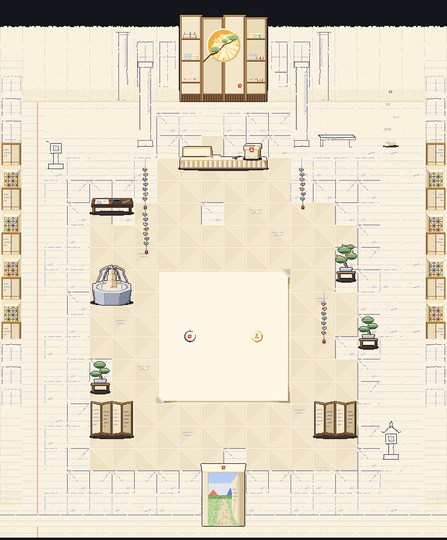

# Folio's sanctuary: inside the Folded House, and its shopkeeper (Nov 5)

Brief: `notes/briefs/brief-folio-sanctuary-art.md` (Eric's ideas, Nov 5; the director's calls). Drawings:
`house-shop-folio/house-shop-folio.ts` (the room, built as Hollow's and Timber's shops are), `house-shop-folio/paper-kit.ts`
(the palette and the paper drawing shared with the turtle and the intro props) and `sidekick-folio-turtle/sidekick-folio-turtle.ts`
(the shopkeeper, built as the other sidekicks are). The intro is in `intro-folio-nov5.md`. Art only: no app code changed.

## Cost
**Drawn by hand on the weekly plan usage**, not with the API runner. No API spend. The exports and format match the runner's.

## The idea: the room is a page still being written

- **The middle is written:** folded, coloured and solid. The floor is folded paper squares (a crease on one diagonal, the
  crease turning square to square, so the floor makes a quiet diamond lattice; a few squares carry a line of faint cursive).
  The stained glass, the fountain, the bonsai, the crane strings, the screens and the desk stand here.
- **Toward the edges and the back it thins into ink sketch.** How written a square is comes from `unwritten(col, row)`
  (exported): 0 at the clean page's middle, about 1 at the side walls and the front, past 1 at the back (the back fades
  sooner), a little uneven square to square so the written part reaches out here and stops short there. Below `WRITTEN`
  (0.66) the floor is folded; below `SKETCH` (0.82) it's the same square drawn only in blue-black ink on blank cream (the
  grid's lines broken here and there, a crease started and left, a hatch or two) over **faint ruled lines**; beyond that,
  ruled blank paper; the back row is unruled (unwritten). **The margin line** (pale vermilion) runs down the west side
  (column 1).
- **Drawn only as outlines:** two pillars flanking the shop, a bench, two stone lanterns, and on the back wall a shoji
  lattice and a pillar, all blue-black lines on blank cream, some lines unfinished.
- **The far wall fades into unwritten paper:** blank hung sheets, deckled at the top; the sketches thin out away from
  the backdrop. The side walls are solid (folded shoji, stained glass) in the middle rows and sketched toward the front and
  back.
- **Lines writing themselves in** (calm, never glitchy): the stone lanterns' roofs write themselves in (the pen's dot
  running ahead), hold, fade back into the paper, and rest unwritten (16 x 180 ms; `-b` out of step); two back-wall
  lattices do the same with one bar (`wall-writing`, `-b`, half a loop apart). See
  [loops-3x.gif](house-shop-folio/loops-3x.gif).

## The pieces

| piece | size (px) | foot | squares | idle | placed (col, row; f = flipped) |
| --- | --- | --- | --- | --- | --- |
| backdrop | 148 x 150 | 74, 149 | 4 x 1 | | 8,0 |
| counter | 148 x 40 | 74, 37 | 4 x 1 | | 8,3 |
| crate | 32 x 30 | 16, 28 | on the counter at `SHOP_FOLIO_CRATE_AT` (122, 21) | 8 x 200 ms | 8,3 |
| fountain | 74 x 92 | 37, 88 | 2 x 1 | 8 x 120 ms | 4,9 |
| bonsai | 37 x 70 | 18, 66 | 1 x 1 | | 16,11; 4,13 |
| bonsai-cranes | 37 x 70 | 18, 66 | 1 x 1 | 8 x 260 ms | 15,8 |
| cranes, cranes-b (not solid) | 37 x 130 | 18, 129 | 1 x 1 | 12 x 240 ms | 6,6; 14,12 / 13,6; 6,8 |
| pages (not solid) | 37 x 130 | 18, 127 | 1 x 1 | 20 x 200 ms | 17,2 |
| screen | 74 x 70 | 37, 66 | 2 x 1 | | 4,15; 14,15 |
| desk | 74 x 44 | 37, 41 | 2 x 1 | | 4,5 |
| sketch-pillar | 37 x 150 | 18, 148 | 1 x 1 | | 6,2; 13,2 |
| sketch-bench | 74 x 40 | 37, 37 | 2 x 1 | | 14,2 |
| sketch-lantern, -b | 37 x 76 | 18, 73 | 1 x 1 | 16 x 180 ms | 2,3 / 17,16 |
| wall, wall-b, wall-sketch, wall-pillar-sketch | 37 x 130 | 18, 129 | 1 x 1 | | row 0 (east half flipped) |
| wall-writing, -b | 37 x 130 | 18, 129 | 1 x 1 | 16 x 180 ms | 7,0 / 12,0f |
| side-shoji, window, window-b | 37 x 130 | 18, 129 | 1 x 1 | | columns 0 and 19, rows 5-13 |
| side-sketch, -b, side-blank | 37 x 130 | 18, 129 | 1 x 1 | | columns 0 and 19, rows 1-4 and 14-18 |
| hem | 37 x 24 | 18, 23 | 1 x 1 | | row 19 but the door (east half flipped) |
| entrance (the way out) | 74 x 112 | 37, 111 | 2 x 1 | | 9,19 |
| floor tiles (`floor-*`, `page-<col>-<row>`) | 37 x 37 | 18, 18 | 1 x 1 | | every square |

- **The windows:** tall panes of tissue lit from behind, cut in triangles (a fold pattern) with kraft leads, in a folded
  frame (four faces mitred), gilt round the panes, lighter toward the top. `window` is rose, gold and blue; `window-b` jade,
  violet and gold; the east wall swaps them so facing windows differ. Four on each side wall (rows 6, 8, 10, 12).
- **The fountain:** a folded stone-paper basin (octagonal, crisp facets lit from the left), a stepped tower of folded paper,
  and its water: two ribbons of paper (cream, a line of cursive running down them) and two of ink (blue) pouring from the
  tower's top and arcing into the basin, the paper ones looping on the way; the pool is rings of ink on cream. Idle: the
  ribbons' stripes run down them (they flow), the rings spread, little curls where they land.
- **Bonsai:** folded on a low kraft stand, a stone-paper tray, an angular trunk of folded brown paper, pads of pleated
  green paper like little fans. `bonsai-cranes` has three tiny cranes perched in it; the gold one flutters now and then.
- **The crane strings** (senbazuru): seven small cranes in tissue colours on a thin ink-blue thread, a vermilion and gold
  tassel; they sway more toward the foot, the two pieces out of step and in a different colour order. The thread is its own
  layer without an outline, so it stays a thin line.
- **Pages drifting upward** in the back-east corner: a little pile on the floor and five pages rising very slowly, turning
  (face, edge-on, back), swaying; near the top each thins to an ink outline and is gone.
- **Screens:** four panels zigzag, lit and in shade, kraft frames, gilt tops, cursive on them.
- **The desk:** dark folded kraft, a sheet half written, an inkstone with wet ink in its well, a brush on a rest, the seal block.
- **The door:** a folded-paper doorway (gilt lintel, Folio's seal on it), its door a flap folded open, the town square in
  daylight through it.
- **No real place, temple, brand or script:** the only writing anywhere is Folio's cursive scribble.

## The battle spot: the clean page
A large blank sheet on the floor (columns 7-12, rows 8-13; 4 px in from its squares), the brightest paper in the room. Its
edges are lifted a hair (a soft shadow south and east, wider toward the corners) and two corners (north-east, south-west)
curl up to show the paper's back. **The marks**, on its middle line (y = 11 x 37 px, as Timber's fix): Folio's (west) is a
brush ring in blue-black ink (heavier at its lower left, open at its upper right, a dry flick) round its vermilion seal;
yours (east) is a gilt ring with a small gilt pawn. `SHOP_FOLIO_MARKS = { boss: [8, 10.5], you: [11, 10.5] }`, the other shops'
spacing. The 36 page tiles are each drawn where they lie (`page-<col>-<row>`, not turned).

## The counter, the crate, the shopkeeper
- **The counter** is a low folded-paper writing counter, **19 px tall** (the turtle is low; at 29 px it hid all but its
  pages). Its top is a lit strip with a gilt front edge, its front pleated, its ends folded in. **The blank plaque is a
  folded tent card standing on its top at the west end** (`SHOP_FOLIO_COUNTER_SIGN`, 44 x 13, a gilt frame; the game writes
  on it). A stack of folded pages and a brush on a rest sit beside it; the middle is left clear for the turtle.
- **Folio's Boss Crate:** a masu box with its lid on, sealed with Folio's vermilion seal across the seam (a seal with the
  paper pawn knocked out of it). Idle: now and then the lid lifts a hair, a sliver of light under it, the seal's halves part,
  and it settles. `SHOP_FOLIO_CRATE_AT = [122, 21]`.
- **The shopkeeper: a paper turtle** (`sidekick-folio-turtle`, export `sidekickFolioTurtle`): old, slow and kind, folded
  from the same handwritten paper (Folio's palette). Its shell is faceted (a middle plate with a line of cursive and a ring
  of folded facets, crisp creases, gilt along its rim); a tiny stack of folded pages on its back tied with a vermilion
  thread; small round gilt spectacles on a long folded head with a soft smile. 64 x 64, foot (33, 59), facing our right,
  lit from the top left. **No name: its card reads "Shopkeeper".** It isn't a town bot.
  - **idle** (12 x 200 ms): slow breaths (the shell rises a pixel), a nod, a slow blink, a glint across its spectacles, the
    top page's corner lifting in a draught.
  - **walk** (8 x 150 ms, slow): legs in diagonal pairs, a pixel's sway, the head bobbing forward; `step` on f0 and f4.
  - **sit** (10 x 240 ms): settled on its plastron, legs tucked as stubs, head raised to the board; it peers over its
    spectacles, nods, blinks.
  - **wave** (once, 10 frames, about 1.9 s): it lifts its near front leg slowly and waves it twice, smiling, then sets it down.
  - **GIFs (3x):** [idle](sidekick-folio-turtle/gifs/sidekick-folio-turtle-idle.gif),
    [walk](sidekick-folio-turtle/gifs/sidekick-folio-turtle-walk.gif),
    [sit](sidekick-folio-turtle/gifs/sidekick-folio-turtle-sit.gif),
    [wave](sidekick-folio-turtle/gifs/sidekick-folio-turtle-wave.gif).
- The origami frog (`sidekicks/folio.ts`) stays a town bot.

## Views (mockups through the town's close camera, phone 390 x 844; the ceiling is the mockup's)
- [At the door](house-shop-folio/view-close-at-door.png): the clean page and its marks ahead, the shop at the back.
- [On the page](house-shop-folio/view-close-on-page.png): on your mark.
- [The fountain](house-shop-folio/view-close-fountain.png).
- [The bonsai](house-shop-folio/view-close-bonsai.png), the east windows at the edge and their pools on the floor.
- [The counter with the turtle](house-shop-folio/view-close-at-counter.png).
- [The "being written" edge](house-shop-folio/view-close-edge.png): the west-back corner, the margin line, the ruled
  floor, the sketched lantern and lattice, the written floor stopping short.
- The animated pieces at 3x on one clock: [loops-3x.gif](house-shop-folio/loops-3x.gif).
- Made by `scripts/boss-art/intro-folio-view.ts room <out> <col> <row> close phone [t]` (it draws the windows' pools and
  halos as the notes below describe) and `scripts/boss-art/folio-stills.ts` (the room still, piece sheets, the loops).

## For the code helper
- **Exports:** `SHOP_FOLIO_PIECES`, `SHOP_FOLIO_LAYOUT`, `HOUSE_SHOP_FOLIO`, `SHOP_FOLIO_COUNTER_SIGN`, `SHOP_FOLIO_CRATE_AT`,
  `SHOP_FOLIO_MARKS`, `SHOP_FOLIO_LIGHTS`, `SHOP_FOLIO_POOLS`, and `unwritten` / `WRITTEN` / `SKETCH` (the zones). It's a
  box room: **no floor mask** (`SHOP_FOLIO_FLOOR` not needed).
- **Flat tiles:** `floor-*` and `page-<col>-<row>`. ShopRoom's `isFloor` prefixes need `page` added.
- **Lights:** each window's panes light in their own colours (one `SHOP_FOLIO_LIGHTS` entry per colour, so each halo is its
  colour); the backdrop's moon window glows gold. Repeated pieces (the windows) light at every place; a flipped placement
  mirrors x.
- **Pools that drift:** each window throws three coloured pools into the room (a west window's to the east; the east wall's,
  flipped, to the west), in a slanting line. Each has a `drift` (`PoolDrift`: `dx`, `dy`, `ms`, `phase`): its middle swings
  `dx`, `dy` px either way on a sine over `ms` (40 s), all on one sun. ShopRoom draws pools still today; it needs that sine.
  The mockup lays a pool's colour over the paper (multiply, soft-edged); on the pale floor an added light barely shows.
- **Folio's shadow on this floor:** FOLIO's shadow (`z`, near-black) is made for the town's dark ground and cuts a hard bar
  on pale paper. The intro character uses a warm see-through brown (`BOSS_FOLIO_INTRO`); the battle's Folio here should too.
- **The turtle has no town sheet yet:** it needs baking (`scripts/bake-sidekicks.ts`, from a copy in
  `packages/app/src/characters/sidekicks/`). Keeper squares `{ c: 9, r: 2 }, { c: 10, r: 2 }`, `at: [9.5, 2.4]`.
- **The ceiling:** pale folded paper, its pleats running up to a fold overhead, as the mockup's.

## Calls Eric may want to change
1. **How the room fades:** written in the middle (about columns 4-15, rows 5-16), sketched in a ring, ruled blank at the
   very edge, the back fading soonest. The edge is uneven on purpose. It could fade sooner or later.
2. **The margin line is on the west side** (pale vermilion, like a notebook's).
3. **The floor's folded squares** make a quiet diamond lattice. It could be plainer (no creases) if it's too busy close up.
4. **The windows are on the side walls** (four a side), not the back, so the back can fade to blank paper.
5. **One fountain** (2 squares, by the clean page's west side), not two.
6. **The counter is low (19 px) with the plaque as a tent card on its top**, so the low turtle shows. A taller counter
   would hide it.
7. **The crate's seal is across the seam**, so its halves part a pixel when the lid lifts.
8. **The marks:** Folio's an ink brush ring round its seal, yours a gilt ring with a pawn.
9. **The turtle:** gilt spectacles, the page stack tied with vermilion thread, it sits on its plastron at a table, it
   waves a front leg. No name.
10. **Extras of mine:** the moon window of gold tissue on the backdrop with a folded branch across it, shelves of folded
    goods (scrolls, tissue stacks, masu boxes, small cranes), the doorway's seal, the lines writing themselves on the back
    wall as well as the lanterns.
11. The mockup's pools are a colour laid over the paper; how strong they look in the game is ShopRoom's to tune.
