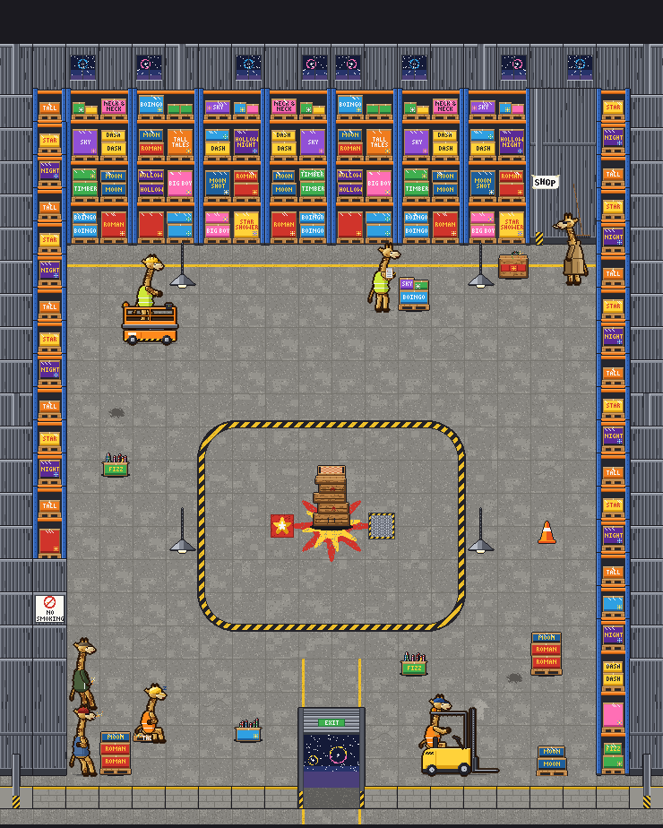

# Jefferson's shop: a shady firework warehouse run by giraffes (Nov 4)

Brief: `notes/briefs/brief-jefferson-art.md` (Eric's design, Nov 4, with the Addition: about 8 giraffes in all). This round is
art only. No app code was changed.

The drawings:
- `house-shop-grex/house-shop-grex.ts`: the room, built the same way Wrangler's barn is, with a floor mask like Hollow's cave.
- `house-shop-grex/warehouse-kit.ts`: shared by the room, the crew's pallet and the intro's table. It holds the colors, the
  lettering, the cartons, the pallets and the crates. Copy it next to the shop's art, as `hunchess-bucket.ts` was.
- `npc-grex/giraffe-rig.ts`: the crew's giraffe, one rig for all seven.
- `npc-grex/npc-grex.ts`: the crew, the two machines and the loose pallet.
- `sidekick-grex-dealer/sidekick-grex-dealer.ts`: the shopkeeper.

## Cost
**Drawn by hand on the weekly plan usage** (Eric, Nov 4), not with the API runner. There was no API spend. The exports and
the format match what the runner makes.

## The room: 20 x 20 squares, 37 px a square, a 16 x 16 floor

### The floor mask: `SHOP_GREX_FLOOR`
- 20 rows of 20 characters: `.` is floor and `#` is stock or wall, as Hollow's cave.
- The walkable floor is **columns 2-17, rows 3-18**: 16 x 16, square. Eric said about 15 x 15. I made it 16 because 16 puts
  the battle spot's middle on the usual table spot (9.5, 10.5).
- The way out is row 19, columns 9-10. Everything round the floor is racking or wall.
- **Blocking:** block every `#` square, as for Hollow's.

### The racking
Warehouse-club pallet racking: blue uprights with slots, orange beams with safety pins, a dark inside, and three levels over
the floor's own level. The beam tops are **46, 92 and 138 px** over the floor (`SHOP_GREX_RACK_LEVELS = [0, 46, 92, 138]`).
Each level holds pallets of firework cartons. The rows are copies with small changes, as Eric said was fine.
- **The back row** is on row 2, columns 2-15: seven 2 x 1 racks, `rack-a` to `rack-d`.
- **The sides** are 1 x 1 cards: column 1, rows 2-14, and column 18, rows 2-18 (`rack-side`, `-b`, `-c`).
  - The east racks are **not mirrored**, so their lettering reads.
  - `rack-side-slot` at **(18, 17)** has its level 1 empty: that is the forklift's shelf slot.

### The cartons
Every carton has a made-up name in the town's sign capitals (3 x 5 px), white or black, with a little burst on it:
- the boss nods: BOINGO ROCKETS, TIMBER TUMBLERS, DASH DAZZLERS, WRANGLER ROUNDUP, HOLLOW NIGHT, BIG BOY BOOMERS and
  PUDDLES POPPERS;
- the rest: MOON SHOT, ROMAN CANDLES, SKY STRIPES, FIZZ WHIZ, STAR SHOWER, TALL TALES and NECK & NECK.

A carton too small for both lines shows its first line only. There are no real brands. The names read in the close camera
and are small from the challenge camera.

### Floor, walls and lights
- **Floor:** grey concrete with a seam round each slab, aggregate specks and soft trowel patches. The tiles:
  - `floor-a`, `floor-b`: plain;
  - `floor-c`: a crack;
  - `floor-d`: an oil stain;
  - `floor-stock`: scuffed, on every `#` square.
- **Painted lines:**
  - `floor-line-n`: a yellow keep-clear line along the racks on row 3;
  - `floor-line-w`, `-e`: a yellow walkway from the door (columns 9-10, rows 15-18);
  - `floor-arrow`: a worn white arrow for the forklift's lane, at (14, 16).
- **Walls:** corrugated blue-grey steel, 150 px tall at the back. `wall-win` and `-b` have high windows onto the night, with a
  firework far off. `wall-post` is a steel I-beam column, safety-striped at its foot.
- **The NO SMOKING sign:** the west wall is bare at rows 15-18. `wall-side-sign` at (1, 16) carries a generic NO SMOKING
  sign (a red ring and bar over a cigarette). It sits in the card's top 37 px, because the cards in front hide the rest. The
  joke: the two leaners under it hold sparklers like cigarettes.
- **Front and way out:** a low concrete-block wall with a yellow top (`hem`), I-beam corner posts (`hem-post`), and the
  `entrance` (2 x 1, columns 9-10). The entrance is a roll-up door rolled up, showing the night lot outside, a firework
  bursting over it and a green EXIT sign.
- **Lamps:** high-bay `lamp` pieces with a steel dome shade and a bright bulb, about 104 px over the floor. They are steady
  (no flicker) and not solid. There are four: (5, 6), (14, 6), (5, 14), (14, 14).

### The battle spot
- **The zone:** a hazard-striped safety zone. It is a rounded rectangle about 8 x 6.4 squares, centred on x = 10 x 37,
  y = 11 x 37, made of 76 `circle-<col>-<row>` tiles, each drawn where it lies.
- **The star:** a red and gold firework star is painted in the middle, where the table stands.
- **The marks** (`SHOP_GREX_MARKS = { boss: [8, 10.5], you: [11, 10.5] }`):
  - His (west) is a red plate with a gold star, 26 px.
  - Yours (east) is **the steel plate of your floor lift**: 30 px (`SHOP_GREX_PLATE`), with a hazard-striped rim, a diamond
    tread and rivets. In the intro, this plate rises on its piston.

### The board on its crate stack
- The board already stands in the battle spot on a wobbly stack of wooden crates: `board-stand`, 2 x 1 at **(9, 10)**,
  solid (`SHOP_GREX_BOARD_AT = { col: 9, row: 10, footDy: 19 }`).
- **The stack:** five slatted crates, the biggest at the foot. Each is a little askew, with red stencilled firework stars and
  "this way up" arrows. The stack is **56 px tall**.
- On top are a plank slab and the chessboard, cream and firework orange.
- **The slab's top is 59 px over the foot** (`SHOP_GREX_TABLE_TOP`). The park tables' slab is at 27.
- **Its foot is [55, 70]** in its 111 x 76 picture.
  - **Place it 19 px south of row 10's middle** (`footDy`), on the marks' line (y = 11 x 37). The mockups' `footOf` does
    this.
  - It is then exactly where the intro draws INTRO_GREX_TABLE (the table spot (9.5, 10.5)), so the intro hides it and draws
    the table there with no jump.
- `crateStack(c, fx, fy, sway)` (exported) draws the stack. The intro's table uses it.

### The shop: "literally just a guy in the corner"
- **The corner:** the dealer's corner is the floor's north-east corner. Its back is `corner-shop` (2 x 1 at (16, 2), solid,
  no racking there): a bare stretch of steel wall, a steel column with **a little white sign taped to it saying SHOP in
  marker**, and a push broom leaning on the wall.
  - The sign is white paper, 29 x 15, with the corners taped and one corner lifting. The letters are hand-drawn, thick and a
    bit uneven.
  - It sits at a giraffe's eye height, 76 px over the corner's foot: `SHOP_GREX_SIGN_AT = { x: 3, y: 97, w: 29, h: 15 }` in
    `corner-shop`'s pixels.
- **The dealer** stands in front of it (below).
- **Jefferson's Boss Crate** (`crate`, 36 x 46, foot [18, 42]) stands on the floor beside him at **(15, 3)**, solid.
  - It is a stout wooden firework crate with a red band, a gold star and its lid nailed down.
  - A fat green fuse comes out of the top and curls over. **Idle: the fuse's tip sparks**, 6 x 110 ms, a new spray each
    frame.
  - `SHOP_GREX_CRATE_AT = { col: 15, row: 3 }` is **a floor square, not counter pixels**: there is no counter.
  - `SHOP_GREX_FUSE_TIP = [25, 16]`.
- `SHOP_GREX_COUNTER_SIGN = null`: none is needed (the brief).

### Stock on the floor
| piece | what it is | placed (col, row) |
| --- | --- | --- |
| `pallet-stack-b` | cartons on a pallet | (12, 4), the one the clipboard guy checks |
| `pallet-stack` | cartons on a pallet | (16, 15) and (3, 18) |
| `pallet-seat` | the dozer's low pallet, a flattened carton on it; **its seat is 9 px up** (`SHOP_GREX_PALLET_SEAT_H`) | (4, 17) |
| `box-open`, `box-open-b` | open cartons with loose rockets and candles sticking out | (7, 17); (3, 9) and (12, 15) |
| `cone` | a safety cone | (16, 11) |

### Pieces
| piece | size (px) | foot | squares | placed (col, row) |
| --- | --- | --- | --- | --- |
| rack-a / -b / -c / -d | 74 x 176 | 37, 173 | 2 x 1 | row 2: a at 2 and 12; b at 4 and 10; c at 6 and 14; d at 8 |
| corner-shop | 74 x 176 | 37, 173 | 2 x 1 | 16, 2 |
| rack-side / -b / -c, rack-side-slot | 37 x 176 | 18, 173 | 1 x 1 | column 1 rows 2-14; column 18 rows 2-18 (the slot at 18, 17) |
| board-stand | 111 x 76 | 55, 70 (+19 south, see above) | 2 x 1 | 9, 10 |
| crate (the Boss Crate) | 36 x 46 | 18, 42 | 1 x 1 | 15, 3 |
| pallet-stack | 37 x 53 | 18, 50 | 1 x 1 | 16, 15; 3, 18 |
| pallet-stack-b | 37 x 42 | 18, 39 | 1 x 1 | 12, 4 |
| pallet-seat | 37 x 16 | 18, 13 | 1 x 1 | 4, 17 |
| box-open, box-open-b | 37 x 34 | 18, 31 | 1 x 1 | 7, 17; 3, 9 and 12, 15 |
| cone | 37 x 30 | 18, 27 | 1 x 1 | 16, 11 |
| lamp (not solid) | 37 x 150 | 18, 149 | 1 x 1 | 5, 6; 14, 6; 5, 14; 14, 14 |
| wall, wall-win, wall-win-b, wall-post | 37 x 150 | 18, 149 | 1 x 1 | row 0 (mirrored east of column 9) |
| wall-side, wall-side-sign, wall-side-post | 37 x 130 | 18, 129 | 1 x 1 | columns 0 and 19 rows 1-18; column 1 rows 15-18 (the sign at 1, 16) |
| hem | 37 x 24 | 18, 23 | 1 x 1 | row 19 |
| hem-post | 37 x 60 | 18, 59 | 1 x 1 | 0, 19 and 19, 19 |
| entrance | 74 x 112 | 37, 111 | 2 x 1 | 9, 19 (exit) |
| floor tiles (`floor-*`, `circle-<col>-<row>`) | 37 x 37 | 18, 18 | 1 x 1 | every square |

## The shopkeeper: the shady dealer (`sidekick-grex-dealer`)
- **The look:** a crew giraffe in a long tan trench coat, belted, its collar popped up round his neck. He wears dark
  sunglasses, has a toothpick in the corner of his mouth, and keeps his hooves in his coat pockets.
- **The frame:** 64 x 104, his foot at **[30, 100]**.
- **His height: 79 px** from hooves to ossicones (`DEALER_TALL`), drawn 1:1 at the room's 37 px a square. That is taller
  than the other kids and a little under Jefferson, who is about 84 px to his flames at his town size.
  - **Draw him at his art's size, not `sidekickSquares`**: at 0.87 squares he would come out as small as the other kids. A
    `ShopDef` field such as `tall: 79` would do it.
- **His place:** at **[16.8, 3.2]**, facing west (mirrored), on keeper squares **{c: 16, r: 3}, {c: 17, r: 3}**
  (`SHOP_GREX_KEEPER`). His Boss Crate is on his west and the sign over his shoulder.
- **Animations:**
  - `idle` (loops, 12 frames, 2.1 s): a breath, a slow look one way and the other, and the toothpick flicked up and back.
    Cue `flick` f6.
  - `walk` (loops, 6 x 110 ms): a slouching walk, hooves still in his pockets. Cue `step` f0 and f3.
  - `sit` (loops, 10 x 220 ms): on a stool, the park's 11 px seat. The toothpick flick, cue `flick` f6.
  - `wave` (once, 8 frames, 1.3 s): the dealer's hello. He looks left and right, then holds one side of his coat open, with
    rockets pinned inside on show, a smirk and the toothpick up. Then he shuts it. Cues `psst` f1 and `flick` f3.
- **Baking:** bake him with `scripts/bake-sidekicks.ts` (a copy in `characters/sidekicks/`). The four rows are as for every
  sidekick.

## The crew (8 giraffes with Jefferson; `npc-grex/npc-grex.ts`)
All the crew are one giraffe from `giraffe-rig.ts`: a muted tan with brown patches, a normal giraffe's small head on a long
neck, and short ossicones with dark knobs. Only the clothes differ. **Only Jefferson looks unique**: his big head, his flames
and his bright yellow.
- **Size:** every figure is 64 x 104, foot [30, 100], drawn 1:1 at the room's scale.
- **Facing:** they face our right. Mirror them to face left.
- **Parts:** the parts are shared between frames and between figures (one `PARTS` record).
- **Every figure has** `idle` (his own loop where he stands), `walk` (6 x 110 ms, `step` f0 and f3) and `watch` (round the
  table: 8 x 180 ms, a breath, a nod f4-f5, a blink f7).

| id | who | idle (where he stands) | his place (`SHOP_GREX_CREW`) |
| --- | --- | --- | --- |
| `npc-grex-lift-guy` | the lift guy: a yellow hard hat with his ossicones through it, a lime hi-vis vest | (on foot: hands on hips) | on his lift, below |
| `npc-grex-fork-guy` | the forklift guy: a blue cap, an orange hi-vis vest | (on foot: arms crossed) | in his forklift, below |
| `npc-grex-leaner-a` | a shady leaner: a flat cap, a dark bomber jacket | leaning back on the wall, a **sparkler** at his side fizzing, lifted to his mouth (he ducks his long neck down to it), lowered, a **smoke puff** out and rising; 12 frames, 2.3 s, cues `fizz` f0, `puff` f7 | (2, 16), facing east, under the NO SMOKING sign |
| `npc-grex-leaner-b` | the other: a red beanie with ossicones through it, a denim vest, shades | leaning back, arms crossed, his **sparkler kept in his mouth, fizzing**, a slow nod; 8 frames, 1.6 s, cue `fizz` f0 | (2, 18), facing east |
| `npc-grex-crew-c` | the clipboard guy: a lime vest, a clipboard, a pencil | looking down at the clipboard, up at the pallet, a tick (the ticks build up); 10 frames, 2 s, cue `tick` f6 | (11, 4), facing east, the pallet at (12, 4) before him |
| `npc-grex-crew-d` | the dozer: a hard hat tipped over his eyes, an orange vest | asleep on his pallet, arms folded, breathing, Z's drifting up; 8 x 260 ms, cue `snore` f0. **Seat 9 px** (`NPC_GREX_CREW_D_SEAT`). Also `wake` (once, 4 frames, 560 ms, cue `snort` f0): a start, the hat pushed back, up on his hooves | (4, 17), on `pallet-seat` |

The leaners lean 8 px (their tops to the left): stand them against the wall on their west, the column-1 cards.

### The machines (room scale, side on, facing our right; mirror to face left)
- **`npc-grex-lift`:** the scissor lift with the lift guy on it.
  - **The look:** an orange chassis with a hazard band, four small wheels (two seen), the scissor stack folded flat, a deck
    with a railing, a control box on the front rail, and an amber beacon.
  - **The frame:** 112 x 144, **foot [56, 128]** (the middle of its wheelbase on the ground). The deck is 22 px up at rest.
  - **Animations:**
    - `idle` (6 x 200 ms);
    - `drive` (4 x 120 ms): the wheels turn and the beacon goes round, cue `beep` f0, soft;
    - `up` (once, 4 x 150 ms, cue `whir` f0): **the platform rises 7 px. That's all.** He smiles, satisfied (the joke);
    - `upIdle` (4 x 220 ms) and `down` (once, `whir` f0);
    - `stepOff` (once, 4 frames, 530 ms, `step` f1 and f3): he steps over the near toe board and hops down in front of it;
    - `parked` (empty, the beacon off).
  - **`NPC_GREX_RISE`:** the platform's rise per frame of `up`, `upIdle` and `down`.
- **`npc-grex-forklift`:** the forklift with the forklift guy in it, his long neck poking up through the overhead guard.
  - **The look:** a yellow body with a striped counterweight, the mast, the carriage and the tines, a big front wheel and a
    smaller rear one, and a beacon.
  - **The frame:** 112 x 144, **foot [46, 128]**.
  - **The fork heights** (`NPC_GREX_FORK_H`, the tines' top over the ground): down 1, carry 5, shelf 47, set 43.
  - **Animations:**
    - `idle`;
    - `drive` (cue `engine` f0) and `reverse` (cue `beep` f0, soft): it backs up;
    - `forksDown` and `forksUp` (3 frames each, `hydraulic` f0);
    - `raise` (forks up without a pallet) and `raisePallet` (forks up with one: the same, its rear dipping a px under the
      weight), 7 frames each, `hydraulic` f0;
    - `set` (2 frames, `clunk` f1): down onto the shelf;
    - `lift` (2 frames, `creak` f0): up off it;
    - `lower` (shelf to carry) and `lowerFrom` (from the set height to carry);
    - `stepOff` (4 frames, `step` f1 and f3) and `parked` (empty, forks down).
- **`npc-grex-pallet`:** the loose pallet the code hands about: a wooden pallet with two MOON SHOT cartons, shrink-wrapped.
  36 x 36, **foot [18, 35]**.
- **`NPC_GREX_FORK_AT`:** per forklift animation and frame, **where the pallet's foot goes, in the forklift's pixels**: on the
  tines, 43 px ahead of its foot. For example, carry is [89, 122] and the shelf is [89, 80]. Draw the pallet just after the
  forklift.
- **`NPC_GREX_STEP_OFF`:** `{ lift: [0, 11], forklift: [-6, 11] }`. These are px from the machine's foot, where the guy
  stands once he's off: in front of it (11 px south, a third of a square). Put his own figure there and draw it in front of
  the machine. The machine then plays `parked`.

## The loops (squares: each machine's foot)
- **`SHOP_GREX_LIFT_PATH`:** the scissor lift shuttles along **row 5, columns 4-8**, in front of the west racks:
  (4, 5) start, (6, 5) up, (8, 5) up, (6, 5) up, (4, 5) end.
  - At each `up` stop: `up`, `upIdle` for a beat, then `down`.
  - It plays `drive` between stops, faces east going east and is mirrored coming back.
  - **The whole loop is in view from the challenge camera on phone and computer.**
- **`SHOP_GREX_FORK_PATH`:** the forklift works the **south-east corner, rows 17-18, columns 13-17**. **This is out of view
  from the challenge camera on phone and computer.**
  - **It always faces east**, its forks ahead: it drives forward east and backs up west (`reverse`).
  - **Lap A** (the floor pallet up onto the shelf):
    1. home at (13, 18);
    2. drive to **(15, 18)** for `pick`: `forksDown`, then `forksUp` (the pallet is the forks' now);
    3. back to (14, 18), then up the lane to (14, 17);
    4. drive to **(17, 17)** for `stack`: `raisePallet`, then `set` (at `set` f1 the pallet becomes the shelf's);
    5. back to (15, 17) and `lowerFrom`;
    6. back to (14, 17), then (14, 18), then home (13, 18).
  - **Lap B** (back down off the shelf onto the floor):
    1. (14, 18), then (14, 17);
    2. **(17, 17)** for `unstack`: `raise`, then `lift` (the pallet is the forks' at `lift` f0);
    3. back to (15, 17) and `lower`;
    4. back to (14, 17), then (14, 18);
    5. drive to **(15, 18)** for `drop`: `forksDown` (the pallet is the floor's);
    6. back home to (13, 18).
  - Between waypoints it plays `drive` going east and `reverse` going west. Going north or south it keeps whichever it was
    playing.
- **The pallet's spots:**
  - **On the floor:** `SHOP_GREX_PALLET_AT = [16.16, 18]`.
  - **On the shelf:** `SHOP_GREX_SHELF_SLOT = { col: 18, row: 17, level: 1, lift: 46 }`, raised 46 px.
  - At (17, 17) the forks carry it to 18.16. Ease it the 6 px onto the slot's middle (18) when it's handed over.
- **Clearance:** both loops are clear of the racking, the table, the marks, the walkway from the door and the crew's places.
- **Blocking:** if you stand on, or right in front of, the next square of a path, the machine waits and then goes on.

## For the code helper
- **Exports from `house-shop-grex.ts`:** `SHOP_GREX_PIECES`, `SHOP_GREX_LAYOUT`, `HOUSE_SHOP_GREX`, `SHOP_GREX_COUNTER_SIGN`
  (null), `SHOP_GREX_CRATE_AT` (a floor square), `SHOP_GREX_MARKS`, `SHOP_GREX_LIGHTS` and `SHOP_GREX_POOLS`.
- **New exports:**
  - `SHOP_GREX_FLOOR` (the mask);
  - `SHOP_GREX_BOARD_AT` (with `footDy`) and `SHOP_GREX_TABLE_TOP`;
  - `SHOP_GREX_KEEPER`, `SHOP_GREX_CREW`, `SHOP_GREX_LIFT_PATH`, `SHOP_GREX_FORK_PATH`, `SHOP_GREX_PALLET_AT` and
    `SHOP_GREX_SHELF_SLOT`;
  - `SHOP_GREX_RACK_LEVELS`, `SHOP_GREX_PLATE`, `SHOP_GREX_SIGN_AT`, `SHOP_GREX_FUSE_TIP`, `SHOP_GREX_PALLET_SEAT_H`;
  - `SHOP_GREX_PALETTE` and `crateStack`.
- **Flat tiles:** `floor-*` and `circle-<col>-<row>`. The `isFloor` prefixes already cover them.
- **No counter:** there is no piece named `counter`, so `room.counter` is empty. A tap on the dealer's squares, the crate or
  `corner-shop` should mean talk.
- **Lights:**
  - The lamps (a 30 px halo, a pool under each) stand in four places: light every place, as Hollow's lanterns.
  - The windows' and the doorway's night is cool blue.
  - The crate's fuse has a warm flicker.
- **The roof:** a warehouse roof, like the mockup's dark steel trusses. The tone is day: the concrete is light.
- **The crew's figures:** there are seven giraffes and two machines in the room, plus the dealer. Each has a small idle loop
  (4-12 frames), and the parts are shared.
  - For frame rate, bake them as the sidekicks are baked: one sheet each, rows by animation. All are 64 x 104 except the
    machines (112 x 144).
- **Mockups:**
  - The room still is made by `scripts/boss-art/grex-stills.ts room <out> [frame]`. With `CREW=1`, it draws the crew in
    their places.
  - The sheets are made by `grex-stills.ts sheet`.
- **The crew and machines sheet:** [npc-grex/crew-sheet.png](npc-grex/crew-sheet.png).
  - The dealer: idle, walk, sit, wave.
  - Each crew member: his idle, walk and watch frames.
  - The lift: idle, drive, up, stepOff, parked.
  - The forklift: drive, raisePallet, stepOff, parked.
  - The pallet.

## Calls Eric may want to change
1. **The floor is 16 x 16** (columns 2-17, rows 3-18), not 15 x 15, so the table sits at the usual spot (9.5, 10.5) in the
   middle.
2. **The dealer's corner is north-east.** It is a bare bit of wall with a column, the SHOP sign taped to it at a giraffe's
   eye height, and a push broom. The Boss Crate is on the floor at his west.
3. **His Boss Crate is a wooden firework crate with a red band and a gold star.** Its fuse is green and sparks at its tip.
4. **The dealer's "wave" is a coat flash:** he looks both ways and opens his coat on rockets pinned inside. He has no hat:
   the collar, the shades and the toothpick do the shady part.
5. **The two extra crew are a clipboard guy checking a pallet and a dozer asleep on a pallet** (Z's, his hard hat over his
   eyes). The dozer has a `wake` for the intro.
6. **The sparkler leaners:** leaner A has a flat cap and a bomber jacket. He ducks his long neck down to the sparkler in his
   hoof (a giraffe can't reach his mouth), then puffs. Leaner B has a beanie, a denim vest and shades, and keeps his in his
   mouth. They lean under a generic NO SMOKING sign.
7. **Every resting figure is either wholly in view or wholly out of view from the challenge camera, on both phone and
   computer** (Eric's sprites-on-screen rule).
   - The phone's view is narrow, and the computer's is close, losing rows 16-18 off its bottom.
   - So the **lift loops in view** (row 5, columns 4-8).
   - **Out of view:** the **forklift's loop** (the south-east corner, rows 17-18), the **leaners** (the bare west wall,
     rows 15-18) and the **dozer** (4, 17).
   - **In view on the computer, out of view on the phone:** the dealer (16.8, 3.2).
   - **In view on both:** the clipboard guy (11, 4).
   - This is why the leaners' wall is at the front of the west side, not the middle.
8. **The forklift always faces east** and backs up west. It has no front or back views, so it never turns, as a forklift in
   a narrow aisle. Its loop is two laps (floor to shelf, shelf to floor), so the pallet is never conjured back.
9. **The machine guys step off toward the camera** (in front of their machines), not off the back.
10. **The racks hold three levels over the floor's** (176 px tall). The back wall's high windows show over them, with the
    night and a firework far off.
11. The orange lift, the yellow forklift, the board's cream and firework orange, four steady lamps and the cone were my picks.
