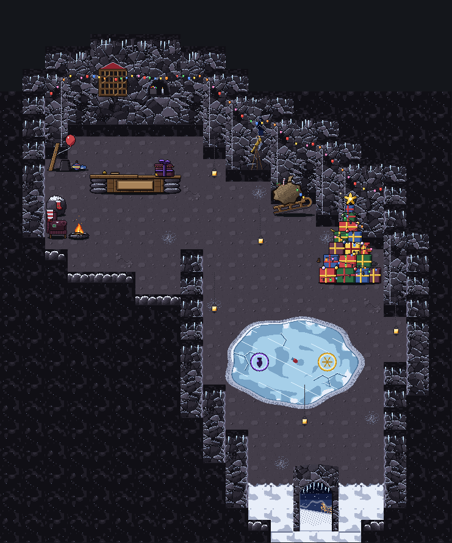
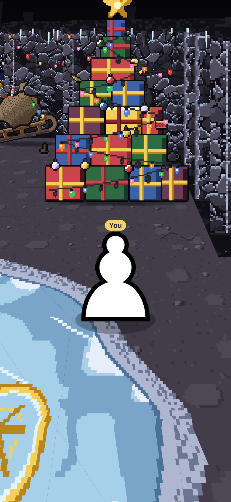

# Hollow's shop: inside Hollow Peak, and his dog (Nov 3)

Brief: `notes/briefs/brief-hollow-cave-art.md` (director's notes). Drawings: `house-shop-hollow/house-shop-hollow.ts` (the
cave, built the same way Dash's and Timber's shops are) and `sidekick-hollow-dog/sidekick-hollow-dog.ts` (the dog, built the
same way the other sidekicks are). This round is art only. No app code was changed.

## Cost
**Drawn by hand on the weekly plan usage** (Eric, Nov 3), not with the API runner. The exports and format match what the
runner makes.

## The theme
Hollow is a lonely soul in a cave above the town who once loved the winter holidays and secretly still loves the lights. The
cave nods to a famous holiday story: a hermit on a mountain, a big sled with an overstuffed sack, a tall pile of presents, a
dog with antlers tied on, a telescope pointed down at the town. It uses none of that story's names, places, lines or
pictures, and it doesn't copy anything from its films. Nothing in the code or the notes names it.

## The room: a cave, not a box


**The floor's shape (`SHOP_HOLLOW_FLOOR`):** a hook. You come in at the mouth (row 19, columns 12-15), go up a passage 6-7
squares wide, and reach a chamber 8-9 wide round the frozen pond (rows 9-14). The cave then bends north-west at the back
(rows 4-8) into a hollow 6-8 wide where the counter stands. The counter is round the bend, so you can't see it from the
mouth.

```
row  0  ####################
row  1  ####################
row  2  ###......###########
row  3  ##........##########
row  4  ##..........########
row  5  ##............######
row  6  ##.............#####
row  7  ###..............###
row  8  ######...........###
row  9  #########........###
row 10  #########.........##
row 11  #########.........##
row 12  #########.........##
row 13  #########.........##
row 14  #########........###
row 15  ##########.......###
row 16  ##########.......###
row 17  ###########......###
row 18  ###########......###
row 19  ############....####
```

Every passage is at least 6 wide. There are no 1-square pinches, and no rock square has floor on two opposite sides. The
pond is wholly on floor. From the mouth to the counter is about 25 steps, 6 or more squares wide all the way.

- **Rock:** dark charcoal-violet stone in faceted, frosted slabs (Hollow's colors, the same as his peak outside). A
  ceiling band runs along the top of every rock piece, with stalactites and icicles hanging from it. Every `#` square has a
  flat tile of rock seen from above (`floor-rock`, `-b`).
- **Floor:** dark packed stone, calm. Each tile has the same tone at its edges, so any tile joins any other. Inside each
  tile there are a few flat stones and specks. `floor-c` has pebbles and a hairline crack, and `floor-d` has a soft
  patch of frost. **Snow** has drifted in at the mouth: `floor-snow` on rows 18-19, then `floor-snow-thin` on row 17. The
  thin tile is bare at its north edge and all snow at its south edge, so it joins both. There are two low snowbanks
  (`drift`) either side of the way out.
- **The way out (`entrance`, 2 x 1, columns 13-14 of row 19):** a rough rock arch with icicles. Through it you see the
  snowy night: a ridge, the slope, the town's lights down in the valley, snow falling past (4 frames), and a drift on the
  sill.
- **Lanterns (`lantern`, `lantern-b`):** old iron lanterns on chains from the ceiling, lit and flickering. They sway a
  little (8 frames). The two pieces are the same lantern swinging out of step, so they never sway together. There are five:
  (9,5), (11,8), (9,11), (17,12), (13,16).
- **The bulb string (`bulbs`, `-b`, `-c`, `bulbs-step`):** his favourite thing. Old, mismatched holiday bulbs (red,
  green, blue, gold, orange, pink, some fatter than others), a few burnt out and one now and then flickering (4 frames).
  It is pinned along the rock from the west corner behind the counter, across the backdrop, round the curve to the tree.
- **Props:**
  - the **sled** (2 x 1, at 12,5): big, wooden, parked against the wall with its curled front propped up on the rock.
    An overstuffed burlap sack is tied on it, with a present, a striped stick and some bulbs poking out.
  - the **tree** (the showpiece, 3 x 2): see below.
  - the **cozy corner** in the counter's hollow: a worn plum velvet **armchair** (2,6) turned to a small **fire pit**
    (3,6). The chair has a green patch, stuffing poking out and a knitted throw. The fire has a ring of frosted stones,
    split logs, a flame and rising embers (6 frames). Next to them is a **stocking rock** (2,5): a waist-high boulder with
    one red knitted stocking on a nail, empty and darned at the heel.
  - the **telescope**: an old brass telescope on a wooden tripod, poked into a crack in the rock (`rock-crack`, at
    11,3). Through the crack you see the night and the town's lights far below, twinkling (4 frames).
  - the **pile** (2 x 1, at 2,3) of things he "borrowed" from the other homes: a plank, a red balloon tied to it and
    bobbing (4 frames), a tin bucket, a spinning top and one mitten.
  - the **advent calendar**, on the backdrop: a little wooden house with a snowy red roof, hung on a nail, with 24 doors.
    Every door has been pried open: swung out, hanging by a corner, or gone.
- **The backdrop** (4 x 1, behind the counter on row 1): the rock rises taller here, with the bulbs across it and the
  calendar. It has a frosted niche holding an old tin of spare bulbs and a candle stub whose flame flickers (4 frames).
- **The counter** (4 x 1, columns 4-7 of row 4): two thick rough planks laid across two stacks of frosted stones, with
  boards in front. It is **30 px tall**, so the dog shows over it. On it sit an old brass service bell and a worn ledger.
  A blank plaque (`SHOP_HOLLOW_COUNTER_SIGN`) hangs in a wooden frame on the front.
- **The crate, Hollow's Boss Crate:** a battered present box in faded plum paper, dented at a corner and torn at the
  bottom, tied with dark violet ribbon in a floppy bow. Faint gold light leaks from the seam under the lid and from the
  tear. Idle: the light inside flickers and a glint winks (6 frames, 200 ms). `SHOP_HOLLOW_CRATE_AT = [122, 16]`, on the
  right of the counter.
- **The battle spot: a frozen pond.** It is an oval about 6 x 4 squares (columns 10-15, rows 10-13), a little
  irregular, centred on x = 13 x 37 and y = 12 x 37. The ice gets deeper toward the middle. It has slanting glints,
  feathers of frost near its edge, a few cracks, a snowy rim and frost on the floor round it. A lost red bulb is frozen
  into the middle, where the table stands, and only just shows. **The marks** are rings etched in the ice on the middle
  line (y = 12 x 37 = 444 in the floor): the boss's (west) is violet with a dark bulb, and yours (east) is gold with a
  snowflake. `SHOP_HOLLOW_MARKS = { boss: [11, 11.5], you: [14, 11.5] }`, the same spacing as the other shops.

| piece | size (px) | foot | squares | placed (col, row) |
| --- | --- | --- | --- | --- |
| backdrop | 148 x 150 | 74, 149 | 4 x 1 | 4,1 |
| counter | 148 x 46 | 74, 43 | 4 x 1 | 4,4 |
| crate | 34 x 30 | 17, 28 | on the counter at `SHOP_HOLLOW_CRATE_AT` (122, 16) | 4,4 |
| showpiece (the tree) | 111 x 178 | 55, 159 | 3 x 2 | 14,8 (columns 14-16, rows 7-8) |
| sled | 74 x 74 | 37, 70 | 2 x 1 | 12,5 |
| pile | 74 x 64 | 37, 60 | 2 x 1 | 2,3 |
| armchair | 37 x 54 | 18, 50 | 1 x 1 | 2,6 |
| fire-pit | 37 x 46 | 18, 40 | 1 x 1 | 3,6 |
| stocking-rock | 37 x 50 | 18, 46 | 1 x 1 | 2,5 |
| lantern, lantern-b (not solid) | 37 x 130 | 18, 129 | 1 x 1 | 9,5; 9,11; 13,16 / 11,8; 17,12 |
| entrance (the way out) | 74 x 112 | 37, 111 | 2 x 1 | 13,19 |
| drift | 37 x 28 | 18, 24 | 1 x 1 | 12,19; 15,19 |
| rock-back, -b, -c; rock-crack | 37 x 130 | 18, 129 | 1 x 1 | see the walls |
| rock-side, -b; rock-corner-out; rock-corner-in | 37 x 130 | 18, 129 | 1 x 1 | see the walls |
| rock-hem, -b; rock-hem-end | 37 x 26 | 18, 25 | 1 x 1 | see the walls |
| bulbs, -b, -c, bulbs-step (not solid) | 37 x 130 | 18, 129 | 1 x 1 | on the rock squares of the string |
| floor tiles (`floor-*`, `circle-<col>-<row>`) | 37 x 37 | 18, 18 | 1 x 1 | every square |

## The walls: which rock piece goes on which edge
The rock pieces stand on **rock** squares that border the floor, and the floor mask decides which one, by
`rockPiece(col, row)` (exported). "Floor to the south" means the square one row down is `.`, and so on.

| the rock square has floor... | piece | flip |
| --- | --- | --- |
| to its south (and not to its west or east) | `rock-back` (or `-b`, `-c`, by `(col * 3 + row * 5) % 3`) | no |
| to its south and its west | `rock-corner-out` (the face turns to the west, lit) | no |
| to its south and its east | `rock-corner-out` | **yes** |
| to its north (and not its south) | `rock-hem` (`-b` on even columns): low, 26 px | no |
| to its north and its east | `rock-hem-end` | no |
| to its north and its west | `rock-hem-end` | **yes** |
| to its east only | `rock-side` (odd rows) / `rock-side-b` (even rows) | no |
| to its west only | `rock-side` / `rock-side-b` | **yes** |
| only diagonally, to its south-east | `rock-corner-in` | no |
| only diagonally, to its south-west | `rock-corner-in` | **yes** |
| none (deep in the rock, or only diagonally north) | nothing upright (the flat `floor-rock` only) | |

There are three exceptions: the **backdrop** replaces the back faces at columns 4-7 of row 1, the **crack** replaces the back
face at 11,3, and the way out and its drifts stand on the floor of row 19.

**The bulb string** is a separate piece standing on the same square as the rock under it, drawn after it. Its pins sit at
the same height in every piece (86 px above the foot), so pieces side by side join. A **level** run uses `bulbs` / `-b` / `-c`.
Where the wall steps a row south at an **outer corner**, use `bulbs-step` (it drops 37 px from west to east), and flip
it when the corner is flipped. The run: 2,2 (step, flipped), 3,1, the backdrop (it has its own), 8,1, 9,2 (step),
10,3 (step), 11,3, 12,4 (step), 13,4, 14,5 (step), 15,6 (step), 16,6.

## The showpiece: his "tree"


- **What:** a tall pile of wrapped presents, 3 x 2 squares, stacked into a tree shape seven rows high (four boxes, then
  three, three, two, one, one, one). The papers are red, green, blue, gold and plum, each with a ribbon. Tucked in among
  them are an old teapot, a boot, a toy drum, a little horn and glass ornaments. A string of old bulbs is wound round it in
  a zigzag up to a gold star on top.
- **Loop:** 10 frames at 150 ms. The bulbs chase up the string, with a third of them dark at a time and one burnt out for
  good. The star's rays flash and sparkles wink round it.
- **Why there:** it stands against the back wall at the top of the passage, so it's the first thing you see from the
  mouth and from the pond, while the counter stays round the bend.
- **Preview:** [showpiece-3x.gif](house-shop-hollow/showpiece-3x.gif).

## Views (mockup; the ceiling is the mockup's, not the art)
- [view-close-at-mouth.png](house-shop-hollow/view-close-at-mouth.png): a few steps in from the mouth. You see snow
  behind you, the pond and the tree ahead, and no counter.
- [view-close-on-pond.png](house-shop-hollow/view-close-on-pond.png): on your mark.
- [view-close-at-counter.png](house-shop-hollow/view-close-at-counter.png): **the dog keeps the shop**, standing behind
  the counter at 5.5, 2.4.
- [view-close-tree.png](house-shop-hollow/view-close-tree.png), and the town zoom from below the pond:
  [view-inside-pond.png](house-shop-hollow/view-inside-pond.png).
- Changes to `shop-view.ts`:
  - `SHOP=hollow` draws a cave roof: dark stone and stalactites.
  - `KIDCHAR=<file>#<export>` stands a drawn kid behind the counter when it has no town sheet yet.
  - **Pieces near the camera now fade out as they do in the game** (ShopRoom's `nearFull` / `nearGone`). Without the
    fade, the narrow cave's rock beside the camera filled the screen.

## The shopkeeper: his dog (`sidekick-hollow-dog`)
- **The look:** a dark, shaggy, droopy-eyed, loyal mutt. He has charcoal and slate fur, a long lighter muzzle with a
  shaggy beard, and a dark nose. His heavy-lidded gold eyes have sagging red lower lids, and they read in the dark. His
  ears are long and floppy. A pair of forked wooden antlers is **tied on with red string** round his brow, with a little
  bow at the side, and the near antler sits a little askew. He wears a chunky knitted scarf, red with cream stripes, far
  too big for him, with one long fringed end hanging down his front. He has a faint violet halo like Glim's. He faces our
  right, lit from the top left, and is about the size of the other kids. The frame is 64 x 64, with his feet at (30, 61).
- **Animations:**
  - **idle** (loops, 12 frames, 2 s): he breathes slowly, his tail sways, an ear twitches, he gives a slow droopy blink,
    and the near antler wobbles on its string.
  - **walk** (loops, 6 frames, 0.66 s): a loose, shaggy trot with the paws in diagonal pairs. His body bobs and his ears,
    scarf and tail flop. A `step` cue plays on two frames.
  - **sit** (loops, 10 frames, 2.2 s): he sits on his haunches with his front legs straight. He breathes, blinks, tilts
    his head up and thumps his tail.
  - **wave** (once, 10 frames, about 1.3 s): he lifts a front paw and waves it, happy, with his tongue out and his tail
    going, then puts it down.
- **GIFs (3x):** [idle](sidekick-hollow-dog/gifs/sidekick-hollow-dog-idle.gif),
  [walk](sidekick-hollow-dog/gifs/sidekick-hollow-dog-walk.gif),
  [sit](sidekick-hollow-dog/gifs/sidekick-hollow-dog-sit.gif),
  [wave](sidekick-hollow-dog/gifs/sidekick-hollow-dog-wave.gif).
- Glim (`sidekick-hollow`) stays as he is and keeps walking the town.

## For the code helper
- **Exports:** `SHOP_HOLLOW_PIECES`, `SHOP_HOLLOW_LAYOUT`, `HOUSE_SHOP_HOLLOW`, `SHOP_HOLLOW_COUNTER_SIGN`,
  `SHOP_HOLLOW_CRATE_AT`, `SHOP_HOLLOW_MARKS`, `SHOP_HOLLOW_LIGHTS`, `SHOP_HOLLOW_POOLS`, and new for the cave,
  `SHOP_HOLLOW_FLOOR` (the mask) and `rockPiece` (the wall rule).
- **Blocking:** `makeRoom` only blocks the room's edge and solid pieces. Every floor square's rock neighbours have a solid
  piece, so the floor is closed in, but the code should also block every `#` square of `SHOP_HOLLOW_FLOOR`. The flat
  `floor-rock` tiles on the rock are not solid.
- **Flat tiles:** `floor-*` and `circle-<col>-<row>` (30 pond tiles, each drawn where it lies, so they don't turn). The
  `isFloor` prefixes already cover them. `showpiece` is deep but upright.
- **Repeated pieces with lights:** the lanterns and the bulb pieces stand in several places. Their `SHOP_HOLLOW_LIGHTS` /
  `_POOLS` entries name the piece and should light every place it stands. ShopRoom's `upOf` keeps one place per name
  today. The bulbs light one spot per bulb color, by key.
- **The dog has no town sheet yet:** it needs baking (`scripts/bake-sidekicks.ts`, from a copy in
  `packages/app/src/characters/sidekicks/`) before it can stand behind the counter. I suggest the keeper squares are
  `{ c: 5, r: 2 }, { c: 6, r: 2 }` and `at: [5.5, 2.4]`.
- **The roof:** a cave roof (dark stone, stalactites), like the mockup's.

## Calls Eric may want to change
1. **The floor's shape:** a hook. The mouth is a little right of centre, the passage runs up the middle to the pond,
   and the cave bends **west** at the back to the counter. It could bend east instead, or curl further.
2. **The pond is an oval** about 6 x 4 squares, not the other shops' 8 x 8 octagon (the cave is narrower). The marks
   keep the usual spacing.
3. **The marks:** a violet ring with a dark bulb for the boss, and a gold ring with a snowflake for you. There is also a
   lost bulb frozen into the middle of the ice (my extra).
4. **The crate's leaking light is warm gold**, not Hollow's violet: old holiday light inside a dark box.
5. **The sled is parked with its front propped up on the rock**, not standing on end against the wall, so the sack can
   sit on it.
6. **The telescope is part of the crack's wall piece**, not a prop on the floor, so it always lines up with the crack.
7. **The cozy corner (chair, fire, stocking) is in the counter's hollow**, so the back of the cave feels like his home.
   The borrowed pile is there too.
8. **The tree stands at the top of the passage**, in view from the mouth. The counter is the thing you can't see.
9. **The bulb string's route:** from the west corner behind the counter, round the curve to the tree, with 3 or so bulbs
   burnt out.
10. **Five lanterns**, and none in front of the counter (it hid the crate in the close view).
11. **The dog:**
    - his antlers are forked wooden twigs (homemade), not real antlers;
    - the string is red, round his brow, with a bow;
    - the scarf is red and cream;
    - he waves like a dog, a paw lifted forward;
    - he sits on his haunches with no stool;
    - his halo is violet, like Glim's;
    - he has no name in the art.
12. **Snow** covers rows 17-19 at the mouth, with a snowbank either side of the two-wide way out.
13. The mockup's near-camera fade is new in `shop-view.ts`. It copies the game, so the earlier shops' stills would look
    the same or better.
