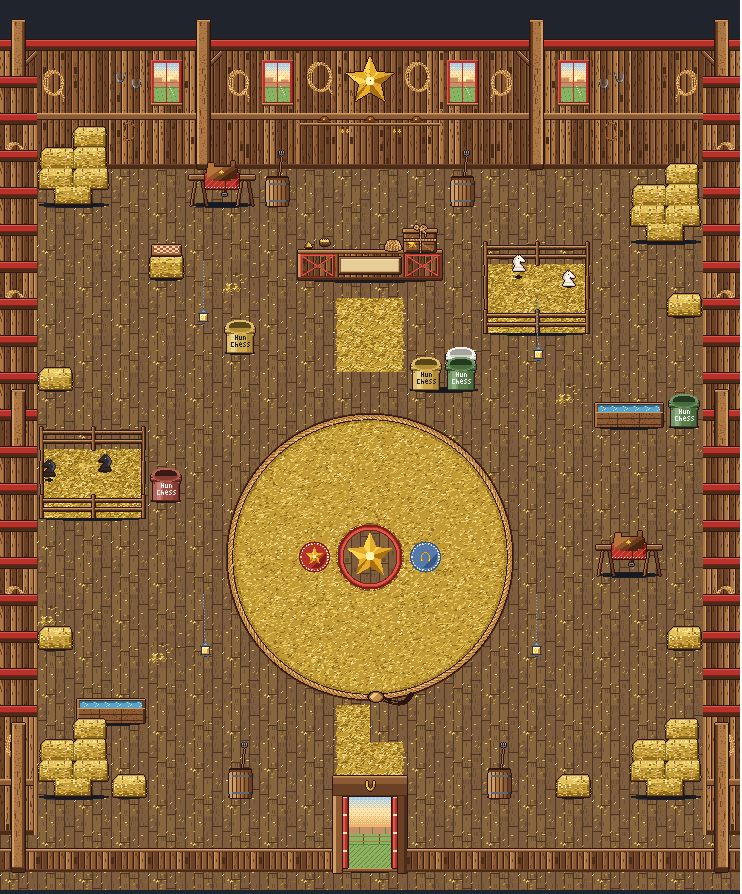
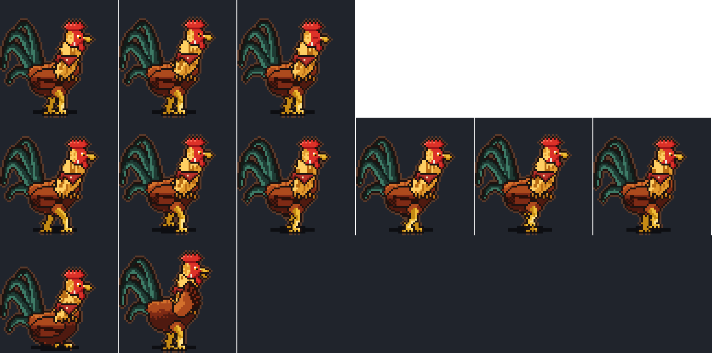

# Wrangler's shop: inside his barn, his rooster and Pen Pony (Nov 4)

Brief: `notes/briefs/brief-wrangler-art.md` (director's notes). Drawings: `house-shop-pig/house-shop-pig.ts` (the barn, built
the same way Dash's and Timber's shops are), `sidekick-pig-rooster/sidekick-pig-rooster.ts` (the shopkeeper, built the
same way the other sidekicks are) and `ride-pen-pony/ride-pen-pony.tsx` (the ride in his crate, in the rides' format). This
round is art only. No app code was changed.

## Cost
**Drawn by hand on the weekly plan usage** (Eric, Nov 4), not with the API runner. There was no API spend. The exports and
format match what the runner makes.

## The room: a normal 20 x 20 box, 37 px squares

- **Floor:** weathered floorboards running north to south (9 px boards, a dark seam, an end joint now and then), with loose
  straw scattered thinly. `floor-c` has a drift of straw in a corner, and `floor-d` a knot in a board and a wisp of straw.
  A **straw path** (`floor-lane-w`, `-e`, two squares wide, ragged edges) runs from the door (rows 15-18) and in front of
  the counter (rows 4-5).
- **Walls:** vertical planks (each its own tone, dark gaps, knots), a heavy top beam painted red (his stall's red), a girt
  across the middle with nails. `wall-b` has a coil of his rope on a peg, `wall-c` two horseshoes and a leather strap,
  `wall-win` a red-trimmed four-pane window onto the evening prairie (mesas, a low sun), and `wall-post` a squared post with
  a knee brace. The side walls are the same planks, with a corner post on the inner edge and a rope coil on every fourth row.
- **Front and way out:** a low plank wall with a rail. The `entrance` (2 x 1, columns 9-10) is the big barn doorway with
  both red doors swung wide, the prairie and a split-rail fence outside, and a gold horseshoe on the lintel.
- **Backdrop** (4 x 1, behind the counter): his tack wall. A big wooden star painted gold, a lasso hung either side, and a
  shelf of three of his hats (gold star on each band) with two pairs of spurs hung under it.
- **Counter** (4 x 1, columns 8-11 of row 3): a plank top over barn-door panels (red frames, X braces). It is **30 px
  tall**. On it are a brass bell, a basket of corn cobs and a coil of rope. It has a blank plaque in a wooden frame
  (`SHOP_PIG_COUNTER_SIGN`).
- **Wrangler's Boss Crate:** a sturdy wooden crate with a lid, a rope tied round it (a band each way, knotted on top, one
  end hanging) and a gold star branded on its front. Idle: a glint runs across the star and winks on the knot (6 frames,
  200 ms). `SHOP_PIG_CRATE_AT = [124, 16]`, on the counter's right.
- **Hay:** `hay-bale` (single, lying, twine round it) and `hay-stack` (2 x 1, five bales stacked three high, one pulled out
  low in front).
- **Lanterns:** iron lanterns on chains from the rafters, lit and flickering, swaying a little (8 frames, 170 ms). As in
  Hollow's cave, `lantern` and `lantern-b` are the same lantern swinging out of step. They are not solid. There are four:
  (5,6), (14,7), (5,15), (14,15).
- **His things:** `saddle` (2 x 1: his saddle on a sawhorse rail, a red blanket under it, a gold star on the skirt, a
  stirrup), `trough` (2 x 1: a plank water trough, its ripples and a glint drifting, 4 frames, 260 ms), `barrel` (iron
  hoops, a pitchfork stood in it).
- **HunChess buckets** (Nov 4, Eric): the same buckets as the intro's stools, standing rim up as decoration, in muted
  colors with "HunChess" reading normally (black or white letters, whichever contrasts). They are `bucket` (green, by the
  trough at 18,7), `bucket-b` (red, by the black knights' pen at 4,9), `bucket-c` (yellow, at 6,5), and `bucket-stack`
  (2 x 1 at 11,6: a yellow one, and a green one with a white one nested in it). The stack and the yellow one are in view
  from the challenge camera. They're only props: the intro's buckets come from off screen.
- **The two pens** (`pen` and `pen-b`, each 3 x 2): split-rail corrals with straw inside. `pen` holds two **white knights**
  and `pen-b` two **black knights** (the town's cream and charcoal). They are chess knight pieces, about 12 x 16 px. Each
  knight hops round a little tour of four **L-shaped moves**. Each L is a long hop of two then a short hop of one at a right
  angle, with a squash on landing. One knight in each pen does a **skip** in place while it rests. It loops in 32 frames x
  110 ms (3.5 s), and the two pens run out of step.
- **The board on its stand** (`board-stand`, 1 x 1, at **(4, 3)**, solid): a hay bale lying on its side, the board's plank
  slab on it, and the chessboard on top (straw cream and barn red). It is set back in the north-west of the room, beside his
  saddle and clear of everything in front of it. **Its foot is [18, 44]** in its 37 x 50 picture, and the slab's top is 27 px
  over the foot, exactly as INTRO_PIG_TABLE's middle (foot [55, 44]). So the intro swaps the piece for the table at the same
  point. `SHOP_PIG_BOARD_AT = { col: 4, row: 3 }`.
- **The battle spot:** a **straw bed inside a ring of rope** laid on the floor. It is a lasso about 7.6 squares across,
  centred on x = 10 x 37, y = 11 x 37, with its knot at the south and the tail curling off it east. In the middle (2 x 2,
  where the table stands), the boards are swept clean, with a red ring and a big gold star painted on them. **The marks** are
  on the middle line (y = 11 x 37 = 407 in the floor). His (west) is a red saddle-blanket mat with a stitched border and a
  gold star. Yours (east) is a denim mat with a gold horseshoe. `SHOP_PIG_MARKS = { boss: [8, 10.5], you: [11, 10.5] }`.

| piece | size (px) | foot | squares | placed (col, row) |
| --- | --- | --- | --- | --- |
| backdrop | 148 x 150 | 74, 149 | 4 x 1 | 8,0 |
| counter | 148 x 46 | 74, 43 | 4 x 1 | 8,3 |
| crate | 34 x 30 | 17, 28 | on the counter at `SHOP_PIG_CRATE_AT` (124, 16) | 8,3 |
| board-stand (the board on its hay bale) | 37 x 50 | 18, 44 | 1 x 1 | **4,3** |
| pen (white knights), pen-b (black) | 111 x 112 | 55, 89 | 3 x 2, deep but upright | 13,4 (cols 13-15, rows 3-4) / 1,9 (cols 1-3, rows 8-9) |
| bucket, bucket-b, bucket-c (HunChess buckets) | 37 x 44 | 18, 40 | 1 x 1 | 18,7 / 4,9 / 6,5 |
| bucket-stack | 74 x 52 | 37, 48 | 2 x 1 | 11,6 |
| hay-stack | 74 x 82 | 37, 78 | 2 x 1 | 1,1; 17,2; 1,17; 17,17 |
| hay-bale | 37 x 32 | 18, 28 | 1 x 1 | 18,4; 1,6; 1,13; 18,13; 3,17; 15,17 |
| saddle | 74 x 56 | 37, 52 | 2 x 1 | 5,1; 16,11 |
| barrel | 37 x 58 | 18, 54 | 1 x 1 | 7,1; 12,1; 6,17; 13,17 |
| trough | 74 x 36 | 37, 32 | 2 x 1 | 16,7; 2,15 |
| lantern, lantern-b (not solid) | 37 x 130 | 18, 129 | 1 x 1 | 5,6; 14,15 / 14,7; 5,15 |
| entrance | 74 x 112 | 37, 111 | 2 x 1 | 9,19 |
| wall, wall-b, wall-c, wall-win, wall-side, wall-side-b | 37 x 130 | 18, 129 | 1 x 1 | row 0; columns 0 and 19 |
| wall-post, wall-side-post, hem-post | 37 x 150 | 18, 149 | 1 x 1 | 0,0, 5,0 (mirrored at 19,0, 14,0); 0,10 and 19,10; 0,19 and 19,19 |
| hem | 37 x 24 | 18, 23 | 1 x 1 | row 19 |
| floor tiles (`floor-*`, `circle-<col>-<row>`) | 37 x 37 | 18, 18 | 1 x 1 | every square |

Back wall from the west corner: post, wall-b, wall, wall-c, wall-win, post, wall-b, wall-win, then the backdrop (8-11),
then the same mirrored (`flip`) except the windows, which are placed unflipped.

## Views (mockups; the roof is the mockup's, not the art)
- [view-close-at-counter.png](house-shop-pig/view-close-at-counter.png): the close camera at the counter. **The rooster keeps
  the shop**, behind the counter at [9.5, 2]. His comb, head and hackle show over it.
- The challenge camera, with you both on the marks (the start of the intro): [phone](house-intro-pig/view-fight-start-phone.png)
  and [computer](house-intro-pig/view-fight-start-computer.png). **The board on its hay bale is in view on both**, top left
  beside the saddle, with nothing in front of it.
- Changes to `shop-view.ts`: `SHOP=pig` draws a barn roof (dark rafters), and `pen` pieces stand upright like `showpiece`.

## The shopkeeper: his rooster (`sidekick-pig-rooster`)

- **The look:** a proud, scruffy barn rooster, chest out. He has a russet body, a shaggy gold hackle down his neck with a few
  feathers sticking out, a big red comb and wattles, a white ear lobe, a fierce orange eye and a yellow beak. His tall arc of
  sickle feathers is black-green with a green sheen. He has yellow legs with spurs and a **tiny red bandana** (cream dots)
  knotted at the back of his neck. He faces our right, is lit from the top left, and is about the size of the other kids.
  The frame is 64 x 64, with his feet at (30, 61) and a faint warm-brown halo.
- **Animations:**
  - **idle** (loops, 12 frames, about 2.3 s): he breathes, his head jerks round to look as a rooster's does, his tail sways,
    he blinks, and he ruffles a wing.
  - **walk** (loops, 6 frames, 0.66 s): a proud strut with the head pumping forward and back. A `step` cue plays on f0 and f3.
  - **sit** (loops, 10 frames, 2.2 s): settled on his belly with his toes tucked under. He breathes, looks round, blinks and
    flicks his tail.
  - **wave** (once, 8 frames, about 1 s): he throws a wing up and out in front of him, beak open in a silent crow, then folds
    it away.
- Wrangler's piglet (`sidekick-wrangler`) stays as he is and keeps walking the town.

## The ride in his crate: Pen Pony (`ride-pen-pony`, mythic)
[look.png](ride-pen-pony/look.png): the three views at 4x, the town size, and the colors.
- **What:** one of the pen knights, saddled. It is a big knight piece: its carved horse's head and neck rise at the front of
  a round two-tier base, with a rope bridle. A leather saddle sits on the base behind the neck, with a gold star on the skirt
  and a stirrup. A **saddle blanket in the item's color** (the only painted part) hangs over the base with a fringe. Rope
  reins run from its mouth to the horn, and a tuft of straw is tied on behind for a tail. **White pawn on a white knight,
  black pawn on a black knight.** The widest frame is about 112 units, within 125.
- **Side view** (facing right): the pawn sits in the saddle behind the neck (`pawnX -6`, `pawnY -6`, `cut 66`).
  - `idle`: 8 frames, about 1.5 s. It breathes and nods, flicks an ear, does one little skip in place, and blinks.
  - `move`: 8 x 85 ms, dx 0 to 87.5. It does **two hopping skips a square** (crouch, spring, up, land), tipping forward on
    the spring and back on the landing, with a kick of dust on each landing that goes along with it.
- **Front view:** its long face toward us, the pawn's head over its ears, and the blanket and stirrups either side. **Back
  view:** its ears either side of the pawn's head, the saddle's cantle with the star, and the straw tail. Both hop in place.
- **Trail:** where it lands, the round print of its base in the dust, with a few wisps of straw (4 frames, 600 ms, 36 x 26).
- The description reads: "One of Wrangler's pen knights, saddled up. It won't go straight, but it hops like nobody's business."

## For the code helper
- **The HunChess bucket** is drawn by `house-shop-pig/hunchess-bucket.ts` (shared with the intro and Puddles' shop):
  copy it next to the shop's art.
- **Exports:** `SHOP_PIG_PIECES`, `SHOP_PIG_LAYOUT`, `HOUSE_SHOP_PIG`, `SHOP_PIG_COUNTER_SIGN`, `SHOP_PIG_CRATE_AT`,
  `SHOP_PIG_MARKS`, `SHOP_PIG_LIGHTS`, `SHOP_PIG_POOLS`. New: `SHOP_PIG_BOARD_AT` (the stand's square, the intro's lasso
  target), `SHOP_PIG_PALETTE` (the intro props use the same colors) and `standBale` (draws the stand's bale; the intro's
  table uses it).
- **Flat tiles:** `floor-*` and `circle-<col>-<row>` (61 tiles, each drawn where it lies, so they don't turn). The `isFloor`
  prefixes already cover them.
- **Deep but upright:** `pen` and `pen-b` (3 x 2) stand like Dash's halfpipe. Don't lay them flat.
- **Lights:** the lanterns (a flicker and a 34 px halo, a pool under each), the windows' and the doorway's evening light
  (and pools), and a faint warm glow on the crate's star. The lanterns stand in four places: as in Hollow's cave, their
  `_LIGHTS` / `_POOLS` entries name the piece and should light every place it stands.
- **The shopkeeper:** the rooster needs a town sheet (bake it from a copy in `characters/sidekicks/`) before he can stand
  behind the counter. I suggest `at: [9.5, 2]` and keeper squares `{ c: 9, r: 2 }, { c: 10, r: 2 }`, as the other shops.
- **The roof:** a barn roof (dark rafters), like the mockup's. The tone is day.
- **Pen Pony** moves into Items.tsx like the other rides (`penPony`: id `ride-pen-pony`, name "Pen Pony", tier mythic).

## Puddles' shop: HunChess buckets too (Nov 4)
Eric asked for a few of the same buckets in Puddles' shop, by his plants and watering things.
`house-shop-puddles/house-shop-puddles.ts` now has three new pieces, in its layout, with `BUCKET_PALETTE` spread into its
palette (keys U+00C0 to U+00E7, free there). It imports `standingBucket` from `house-shop-pig/hunchess-bucket.ts`:
- `bucket-stack` (2 x 1, 74 x 52, foot [37, 48]) at **(4, 3)**, beside the potting bench: a green one, and a yellow one
  with a red one nested in it.
- `bucket` (green, 37 x 44, foot [18, 40]) at **(5, 9)**, by the fountain.
- `bucket-b` (yellow) at **(18, 16)**, by the hose reel.
- All are solid. For the code round: copy `hunchess-bucket.ts` next to the shop's art (`town/shops/`), and copy the three
  `def`s, the palette spread and the three `at(...)` lines into `town/shops/puddles-art.ts`. Nothing else in his shop
  changed. [room.png](house-shop-puddles/room.png) is re-rendered.

## Calls Eric may want to change
1. **The board's stand is at (4, 3)**, beside his saddle, not right in the corner square (2, 2). At (2, 2) or (3, 2) it was
   too small and too near the phone's left edge from the challenge camera, behind the hay. At (4, 3) it reads on the phone
   and the computer.
2. **One pen of white knights and one of black**, two in each, rather than a mixed herd.
3. **The battle spot is a straw bed in a lasso laid on the floor**, with a gold star painted on swept boards where the table
   stands. His mark is a red saddle-blanket mat with a star, and yours a denim mat with a horseshoe.
4. **The floor is plank with straw scattered on it**, not a dirt floor, so the close camera stays calm.
5. **The rooster stands behind the counter**, as the other kids do. His comb and head show over it. Perched on the counter
   would need a lift the shop code doesn't have.
6. **The rooster's wave is a wing thrown up in front of him with a silent crow.** He has no name in the art.
7. **Pen Pony matches your side** (white knight for a white pawn, black for black), and only the blanket takes the item's
   color.
8. Four lanterns, two windows each side of the backdrop, and the backdrop as his tack wall (gold star, lassos, hats, spurs)
   were my picks.
