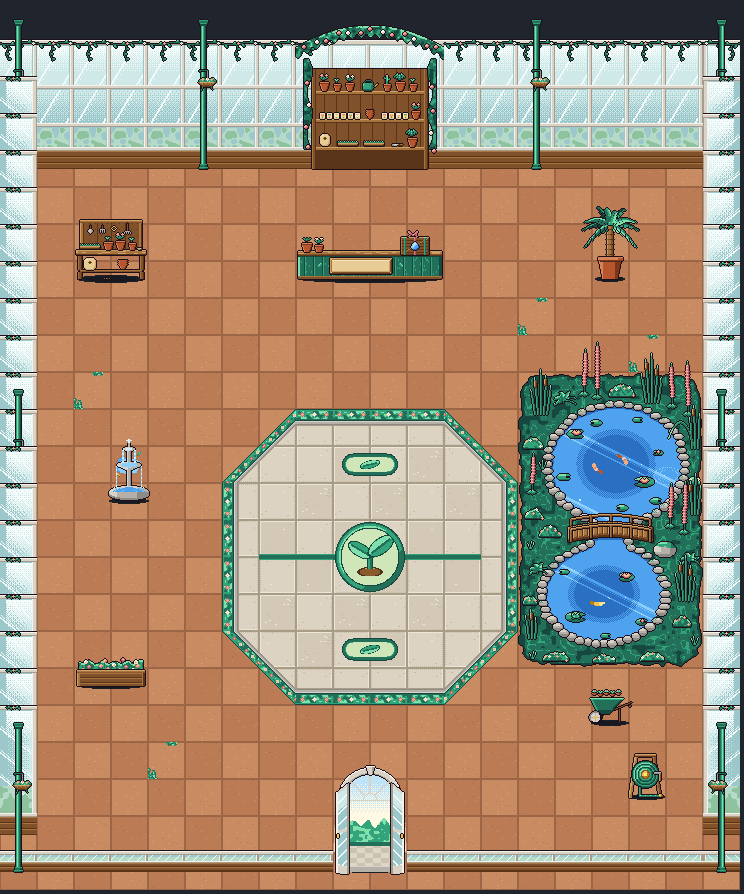

# Puddles' shop: inside the greenhouse (Nov 2)

Eric asked for the inside of Puddles' shop as a botanical-garden greenhouse, with a themed battle circle in the middle
("where future battles will take place, Pokémon gym stylish in a sense") and one animated showpiece, a flower garden and
pond. He approved the spend in the dialog (about $4 to $7, capped at $10). Brief: `scripts/boss-art/briefs/shop-puddles-interior.md`;
decision: `docs/decisions/2026-11-02-building-interiors.md`. Drawing: `house-shop-puddles/house-shop-puddles.ts`, built the
same way as Babur's shop (each piece its own `Character`, `shop-puddles-<name>`, in `SHOP_PUDDLES_PIECES`; placement in
`SHOP_PUDDLES_LAYOUT`; the room still `HOUSE_SHOP_PUDDLES`). Art only: nothing is wired into the game yet. The Shopkeeper
is Drizzle's existing sprite.

## Cost
- Opus 5.5, effort high, the runner's spend guard on, 96,000 tokens a turn.
- **$3.80** over 30 turns and 22 renders.
- It stopped one step short of calling done: a render of all 8 frames of a whole-room view came out wider than the API
  accepts in a many-image request (3,000 px). Every piece was already drawn, and the file typechecks. The renderer now
  shows only the frames that fit (`scripts/boss-art/render.ts`), so this won't stop a run again.
- **The bigger pond (second pass, Nov 2): $2.37** (`house-shop-puddles/summary.md`). The runner was killed for lack of
  memory with the redraw already in place.
- **Shops so far: Babur $7.16 (with both hoop passes), Puddles $6.17.**

## The room: 20 x 20 squares (37 px a square)

- **Back wall:** greenhouse glass in white frames with a vine along the top, green iron columns with hanging baskets.
  Behind the counter, a seed-and-pot shelf under a rose arch.
- **Counter:** row 3, a green plank potting counter with the crate on it. Drizzle stands behind it.
- **Battle circle:** an octagon of pale flagstones at columns 6-13, rows 7-14, with a flowered hedge edge. A sprout emblem
  sits in the middle on a line across the circle, with a leaf start mark north and south.
- **Props:** the potting bench is top left and the palm top right. The fountain is on the left, the flower bed lower left,
  and the wheelbarrow and hose reel lower right. The big pond garden runs down the east side, columns 14-18, rows 6-13.
- **Front:** a low glass wall with open glass doors at columns 9-10, the way out.

## The pieces (width x height in px)
| Piece | Size | Notes |
|---|---|---|
| `floor-a`, `floor-b` | 37 x 37 | Terracotta tiles in two tones, calm. |
| `floor-c`, `floor-d` | 37 x 37 | Moss in the cracks; a puddle and a leaf. |
| `floor-door` | 37 x 37 | Daylight at the doors. |
| `circle-a`, `circle-b`, `circle-line`, `circle-line-b` | 37 x 37 | The arena's flagstones and the middle line. |
| `circle-edge`, `-diag`, `-diag-b`, `-corner` | 37 x 37 | The flowered hedge edge (turned with `rot`). |
| `circle-mark-l`, `circle-mark-r` | 37 x 37 | The two halves of each start mark. |
| `emblem-nw/ne/sw/se` | 37 x 37 each | The sprout emblem, 2 x 2 squares. |
| `wall`, `wall-pillar` | 37 x 130, 37 x 150 | Glass and frames; the column with a hanging basket. |
| `wall-side`, `wall-side-pillar` | 37 x 130, 37 x 150 | Side walls receding (the east one mirrored). |
| `hem`, `hem-pillar`, `entrance` | 37 x 22, 37 x 150, 74 x 112 | The low front and the open glass doors. |
| `backdrop` | 148 x 150 | Shelves of pots and seed packets under a rose arch. |
| `counter` | 148 x 44 | Lower than Babur's 58 px, so Drizzle shows. The brief asked for at most about 32 px. |
| `crate` | 30 x 27 | **Puddles' Boss Crate**: green bands, a water drop on the front, a pink bow. At `SHOP_PUDDLES_CRATE_AT` = (119, 16). Idle: 6 frames. |
| `potting-bench` | 74 x 72 | Tools on a pegboard, pots, a soil sack. |
| `palm` | 64 x 112 | Idle: fronds sway (4 frames). |
| `fountain` | 44 x 72 | Idle: running water (4 frames). |
| `hose-reel` | 44 x 52 | His green hose and a brass nozzle. |
| `flower-bed` | 74 x 42 | Pink flowers in a raised wooden bed. |
| **`pond-garden`** | 185 x 356 (5 x 8 squares) | **The showpiece**, redrawn bigger (Eric, Nov 2: "like 3x the size"). Two pools in rings of stones joined by a wooden footbridge, with koi, lily pads, pink water lilies, a frog, cattails, reeds and pink foxgloves. Idle: 8 frames at 190 ms: ripples, bobbing pads, swimming koi. It was 111 x 96 (3 x 2). |
| `wheelbarrow` | 48 x 46 | Extra: a barrow of seedlings. |

## Inside, through the town's camera (mockup, Close zoom: the default inside)
- At the counter, with Drizzle: [view-close-at-counter.png](house-shop-puddles/view-close-at-counter.png)
- Standing in the battle circle: [view-close-in-circle.png](house-shop-puddles/view-close-in-circle.png)
- The pond garden, animated: [view-close-pond.gif](house-shop-puddles/view-close-pond.gif)

## The bigger pond (Nov 2, second pass)
- **Size:** 9 x 6 squares can't fit beside the battle circle: the east side is only 5 squares wide, and the circle stays
  in the middle. So it's a long pond, 5 squares wide and 8 deep (columns 14-18, rows 6-13). That's 40 squares against the
  old 6, about 6.7 times the area.
- **Moves:** the hose reel moved to (17, 17). The wheelbarrow stays at (16, 15), just south of the pond. The circle, the
  counter and the path from the door are unchanged.
- **Drawn flat:** the pond is drawn as a plan seen from above, and the layout gives its depth (`d: 8`). The mockup lays it
  flat on its 40 squares, with the plants' tops above its north row standing up. Standing the whole picture upright, as
  for the other props, would make it a wall 9 squares high. The code helper must lay it flat too. The catch is that its
  reeds and foxgloves lie flat with the water. If Eric wants them to stand up, a later pass can split the tall plants
  into upright pieces placed round it.
- Zoomed out (the town's view), in the circle: [view-inside-circle.png](house-shop-puddles/view-inside-circle.png)

The glass roof above the walls is drawn by the mockup script, not by the art.
`SHOP=puddles npx tsx scripts/boss-art/shop-view.ts <out.png> <col> <row> 390 844 close`.

## Calls Eric may want to change
- The counter is 44 px tall, not 32. Drizzle still shows over it (see the counter view).
- The pond's tall plants lie flat with it (see above).
