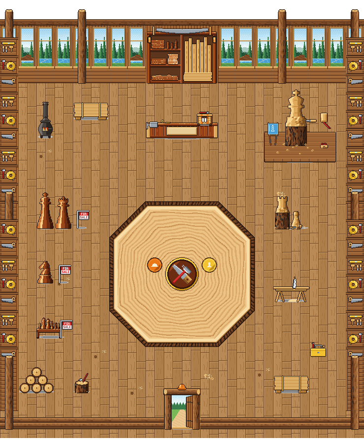

# Timber's shop: inside the Lumber Lodge (Nov 3)

Eric's design (relayed by the director): a lumber theme, plank walls, finished and raw wood behind the counter,
varnished chess pieces big and small with FOR SALE lawn signs, unfinished pieces being carved, and a showpiece for the
artist to pick. He approved the spend in my own dialog (capped at $10). Brief: `scripts/boss-art/briefs/shop-timber-interior.md`.
Drawing: `house-shop-timber/house-shop-timber.ts`. It's art only.

## Cost
**$5.05** of the $10 cap, 35 turns and 22 renders. It finished and called done (`house-shop-timber/summary.md` has
every piece's size and where it stands). **Timber so far: $6.76** (the house $1.71, the shop $5.05).

## The room

- **Floor:** wide honey planks with soft grain, a knot here, sawdust there, and daylight at the door.
- **Back wall:** big windows between log posts onto a pine forest, hills and a blue river, one with a beaver dam.
- **Behind the counter:** varnished shelves of polished boards and small glossy pieces on the left, and a rack of raw,
  lighter planks on the right. A two-man saw and two lanterns hang above.
- **Counter:** a varnished workbench with a vise and a blank plaque, 30 px tall so Rivet shows over it.
- **Crate:** Timber's Boss Crate, raw planks with orange straps, stenciled beaver teeth and a hammer on the lid.
- **For sale:** a big varnished king, queen and knight, and a display table of small pieces, each with a red and white
  FOR SALE lawn sign.
- **Unfinished:** a rook half-carved from a barked log, a rough pawn blank, a chisel, a mallet and shavings.
- **Lumber:** plank stacks, a log pile, a sawhorse with a saw, a chopping block with an axe, a toolbox, and a pot-belly
  stove whose fire flickers.
- **Side walls:** lap boards with saws, levels, chisels and an axe on pegs.
- **The door:** a plank door standing open onto pines and a path.
- **Battle circle:** polished end grain from a giant log, with its growth rings, a sapwood ring and a bark border. A
  hammer crossed with a saw is in the middle. The start marks are round brands on the middle line: the boss's (west) is
  orange with a hard hat, and yours (east) is yellow with a pawn. `SHOP_TIMBER_MARKS = { boss: [8, 10.5], you: [11, 10.5] }`.

## The showpiece: the giant king being carved (the artist's pick)
- **What:** a 112 px king on a plank dais (4 x 2 squares, columns 15-18, rows 3-4). Its crown and body are shaped in raw
  wood with pencil guide lines, and its foot is still the barked log. A blueprint stands on an easel beside it.
- **Loop:** 10 frames at 110 ms. A mallet draws back and strikes the chisel, dust puffs, and five chips arc out and fall.
- **Why:** one strike is a big motion that reads at the town's scale, and it tells the shop's story in one object: a raw
  log becoming a finished piece. The artist judged a lathe's spin too subtle in pixels.
- **Previews:** [showpiece-3x.gif](house-shop-timber/showpiece-3x.gif), and in the room:
  [view-close-showpiece.gif](house-shop-timber/view-close-showpiece.gif).

## Views (mockup, Close zoom; the ceiling and the kid are the mockup's, not the art)
- [view-close-at-counter.png](house-shop-timber/view-close-at-counter.png): **the Shopkeeper here is a stand-in** (the
  bunny kid). Rivet has no town sheet yet.
- [view-close-for-sale.png](house-shop-timber/view-close-for-sale.png),
  [view-close-in-circle.png](house-shop-timber/view-close-in-circle.png),
  [view-inside-circle.png](house-shop-timber/view-inside-circle.png).

## For the code helper
- Exports: `SHOP_TIMBER_PIECES`, `SHOP_TIMBER_LAYOUT`, `HOUSE_SHOP_TIMBER`, `SHOP_TIMBER_COUNTER_SIGN`,
  `SHOP_TIMBER_CRATE_AT`, `SHOP_TIMBER_MARKS`, `SHOP_TIMBER_LIGHTS` (the stove and two lanterns), `SHOP_TIMBER_POOLS`.
- `showpiece` is a deep but **upright** piece (4 x 2): stand it, don't lay it flat.
- **Rivet** (`characters/sidekicks/timber.ts`) needs a town sheet (`town/sidekick-sheets.ts`, `town/sidekicks/timber.png`)
  before he can stand behind the counter.

## Calls Eric may want to change
- The floor planks' end joints fall into a fairly regular brick pattern.
- The showpiece is 4 x 2 squares, so the mallet's swing fits.
- The stove and a third side-wall version were the artist's extras.
